<div align="center">

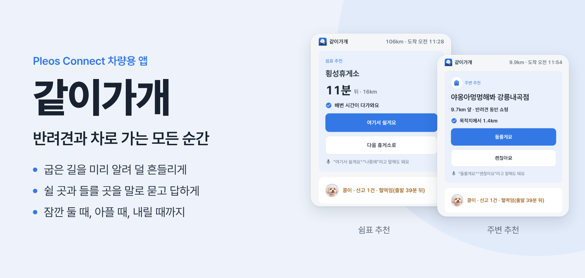

<br>

**반려견을 태우고 운전하는 보호자를 위한 Pleos Connect 차량용 앱**

[시연 영상](#) <!-- TODO 11/13: 영상 주소 --> · [APK 다운로드](#) <!-- TODO 11/13: Releases 주소 -->

</div>

<br>

## 📌 프로젝트 소개

반려견은 차멀미를 하거나 불안해도 말로 알릴 수 없습니다. 운전자는 앞을 봐야 해서 뒷좌석을 살피기 어렵고, 휴게소에 잠깐 두고 내릴 때나 갑자기 아플 때도 무엇을 해야 할지 막막합니다.

같이가개는 차가 이미 알고 있는 정보로 이 문제를 풉니다. 속도와 앞길의 굽은 정도로 차가 얼마나 흔들릴지 미리 계산하고, 기어와 문, 실내 온도로 정차와 하차를 알아차립니다. 운전자는 화면을 만질 필요 없이 말 한마디로 기록하고 답합니다.

| | |
| --- | --- |
| 대상 | 반려견과 차로 여행하거나 병원에 다니는 보호자 |
| 플랫폼 | Pleos Connect, Android Automotive OS |
| 개발 | 1인, 2026년 10월 ~ 11월 |
| 공모전 | 현대자동차그룹 차량용 앱 개발 공모전 |

<br>

## ✨ 주요 기능

**1. 주행 자극 예보**
속도 변화와 앞길의 굽은 정도로 차의 흔들림을 미리 계산합니다. 흔들림이 큰 구간 앞에서 "3km 뒤 굽은 길, 천천히 가면 덜 흔들려요"라고 한 줄과 음성으로 알려 줍니다. 실제 대관령 옛길 15km에서 안내대로 달리면 흔들림 점수가 55에서 30으로 줄었습니다.

**2. 반려견 맞춤 쉼표**
흔들림이 쌓인 정도, 이동 시간, 배변 간격, 운전자 피로를 함께 보고 반려견 놀이터가 있는 휴게소 한 곳을 골라 줍니다. 배변 시간이 다가오면 그 이유를 먼저 알려 줍니다. "여기서 쉴게요"라고 말하면 기본 내비에 경유지가 추가됩니다.

**3. 주변 추천**
주행 중에는 대부분 내비만 보기 때문에 같이가개는 평소에 조용히 있다가, 필요한 순간에만 근처 반려견 장소 한 곳을 알려 줍니다. 목적지 근처의 산책로와 반려용품점, 이상 신고가 있었던 날의 동물병원이 그 대상입니다. 고속도로에서는 차를 세울 수 있는 곳이 휴게소뿐이라 쉼표 추천만 하고, 주변 추천은 일반 도로에서만 합니다. 장소 이름은 모두 관광공사와 인허가 공공데이터에 있는 실제 이름입니다.

**4. 콩이가 이상해요**
운전 중 "콩이 토했어", "계속 헐떡여"라고 말하면 시각과 함께 기록하고, 지금 할 일을 한 줄로 알려 줍니다. 심하면 가까운 동물병원으로 안내합니다.

**5. 긴급 도움과 병원 사전 접수**
멈춰 있을 때 호흡 곤란, 경련, 외상, 위험 물질 섭취 중 하나를 고르면 응급 안내와 가장 가까운 병원이 함께 나옵니다. 제휴 병원에는 보호자가 동의한 뒤 증상과 도착 예정 시간을 미리 보내고, 병원의 답이 차 화면으로 돌아옵니다.

**6. 잠깐 대기**
"잠깐 다녀올게"라고 하면 차 화면이 창밖에서도 읽히는 큰 안내로 바뀝니다. 실내 온도는 차가 값을 줄 때만 보여 주고, 보호자는 휴대폰으로 경과 시간을 확인합니다.

**7. 하차 확인과 도착 리포트**
도착해서 뒷문이 열리면 "콩이 내렸나요?"를 바로 묻습니다. 뒷문이 한 번도 열리지 않았는데 운전석 문만 열리면 한 번 더 알려 줍니다. 하루 이동은 시간 순서대로 한 장에 정리되고, 병원에 그대로 보여 줄 수 있습니다.

**8. 콩이 도우미**
멈춰 있을 때 "쉬할 데 있어?", "물은 얼마나 줘?"처럼 물으면, 앱이 가진 정보(다음 쉼표, 앞길 반려견 놀이터, 실내 온도, 대기 시간)와 공식 자료로 만든 돌봄 카드로만 답합니다. 답에는 출처와 할 일 버튼 하나가 붙습니다. 응급으로 들리는 말은 분류하기 전에 긴급 도움으로 먼저 보내고, 모르는 질문에는 "그건 아직 잘 몰라요."라고 답합니다. 운전 중에는 [눌러서 말하기]로 묻고 음성 한 줄로 듣습니다. 평가 질문 85개를 모두 맞게 분류했고, 응급 질문 20개는 전부 응급 흐름으로 갔습니다. 금지 내용(약 이름, 용량, 진단)은 한 번도 나오지 않았습니다.

> 흔들림 점수는 차량이 얼마나 흔들렸는지를 나타내는 값입니다. 반려견을 측정하거나 진단하지 않습니다.

<br>

## 🖥️ 화면 구성

주행 중에는 Pleos 기본 내비 옆 분할 창에서 동작하고, 멈춰 있을 때는 전체 화면을 씁니다.

<table>
<tr>
<td align="center" width="33%">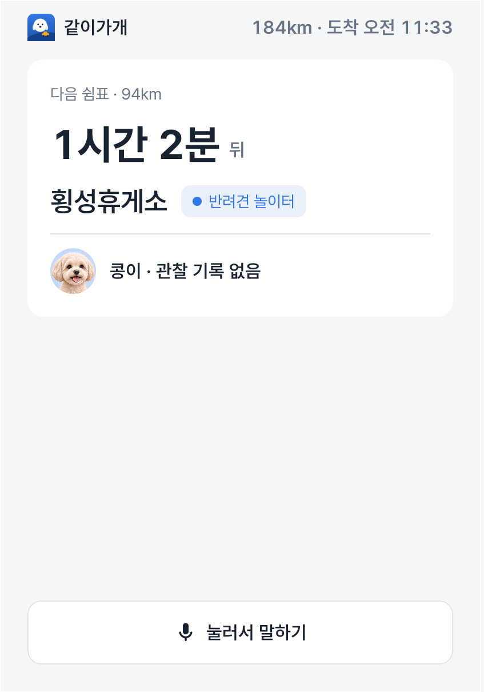<br><b>주행</b><br>다음 회전, 다음 쉼표, 콩이 상태</td>
<td align="center" width="33%">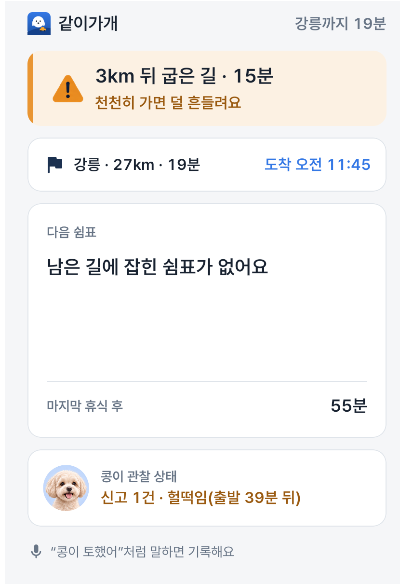<br><b>굽은 길 예보</b><br>숫자 없이 한 줄로</td>
<td align="center" width="33%">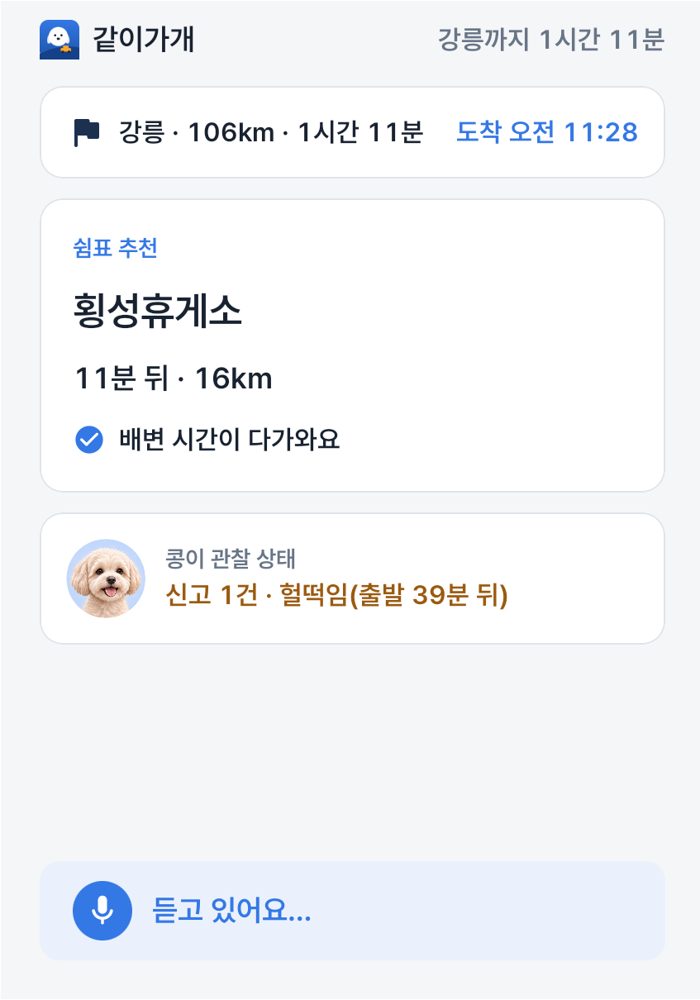<br><b>쉼표 추천</b><br>배변 시간이 다가오면 먼저</td>
</tr>
<tr>
<td align="center" width="33%">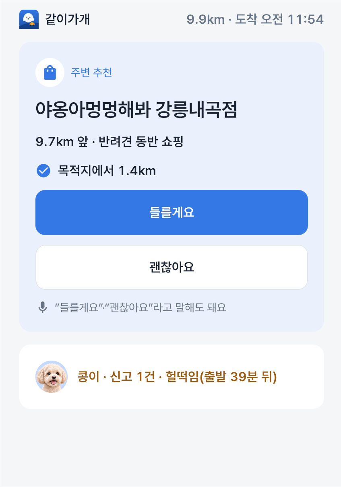<br><b>주변 추천</b><br>목적지 근처 반려용품점</td>
<td align="center" width="33%">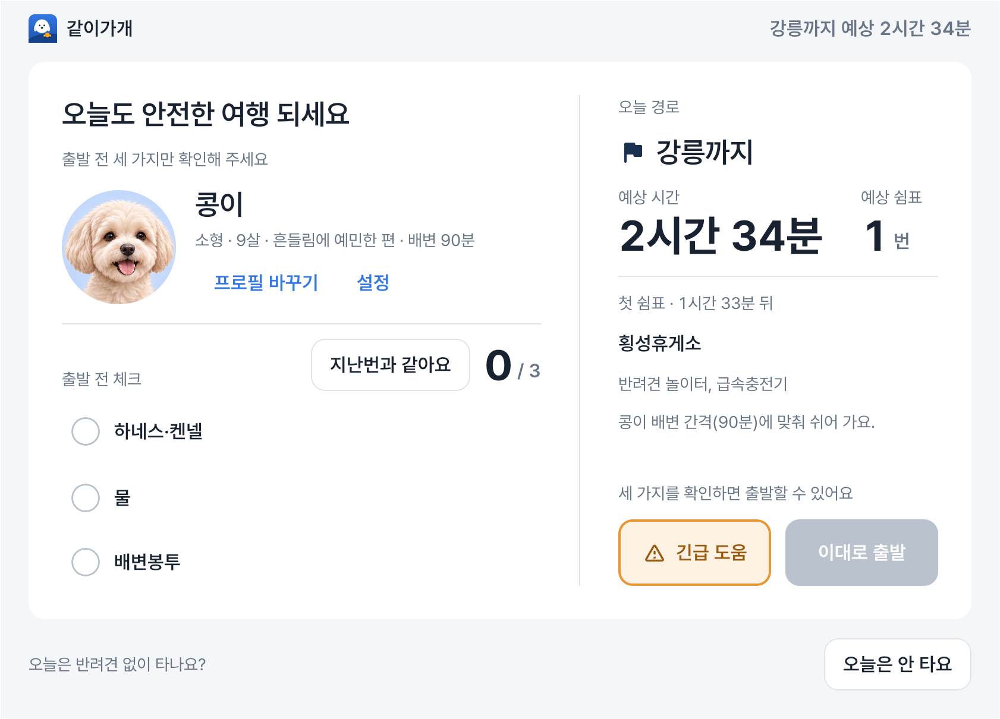<br><b>출발 전</b><br>하네스, 물, 배변봉투 확인</td>
<td align="center" width="33%">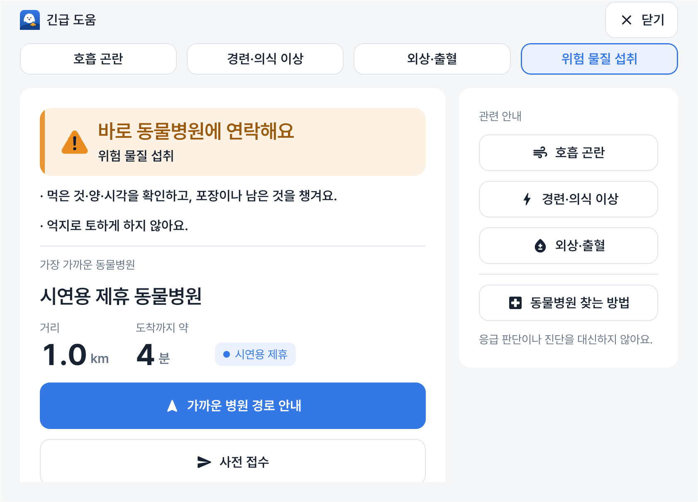<br><b>긴급 도움</b><br>응급 안내와 가장 가까운 병원</td>
</tr>
<tr>
<td align="center" width="33%">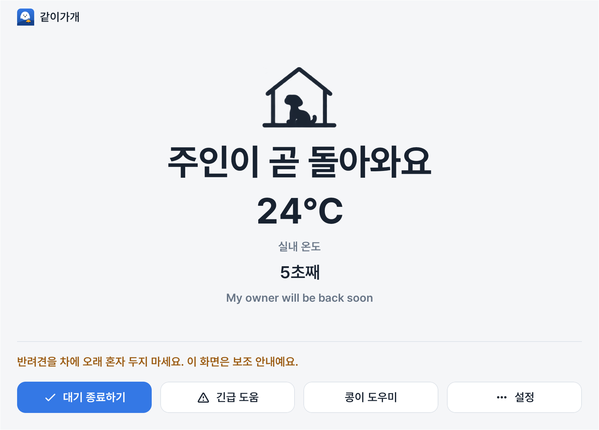<br><b>잠깐 대기</b><br>창밖에서 보이는 큰 안내</td>
<td align="center" width="33%">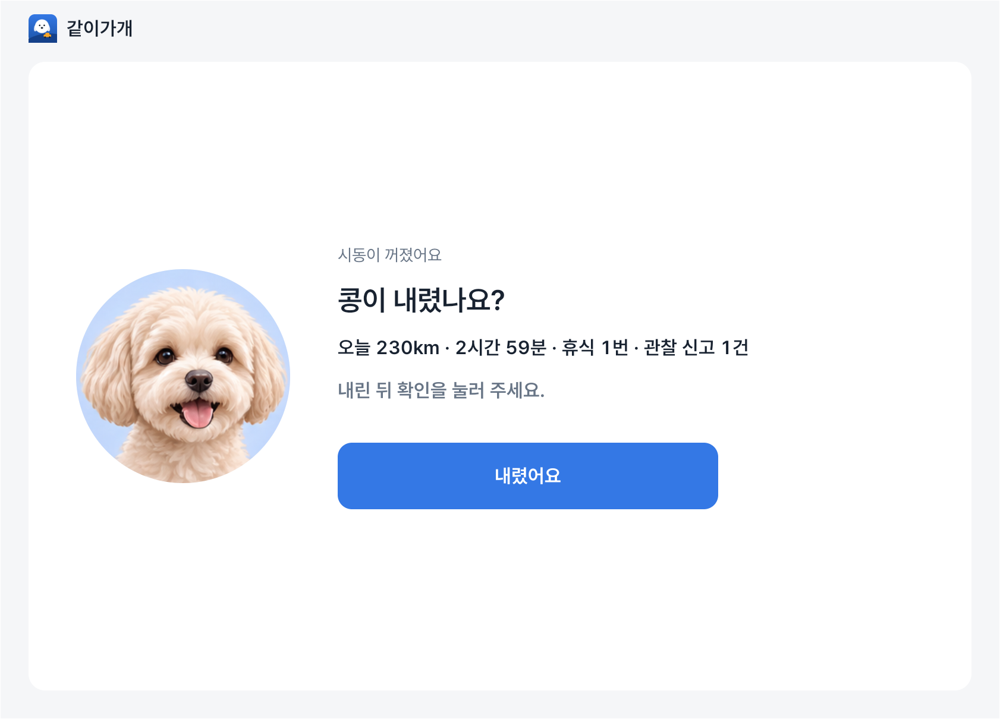<br><b>하차 확인</b><br>뒷문이 열리면 바로</td>
<td align="center" width="33%">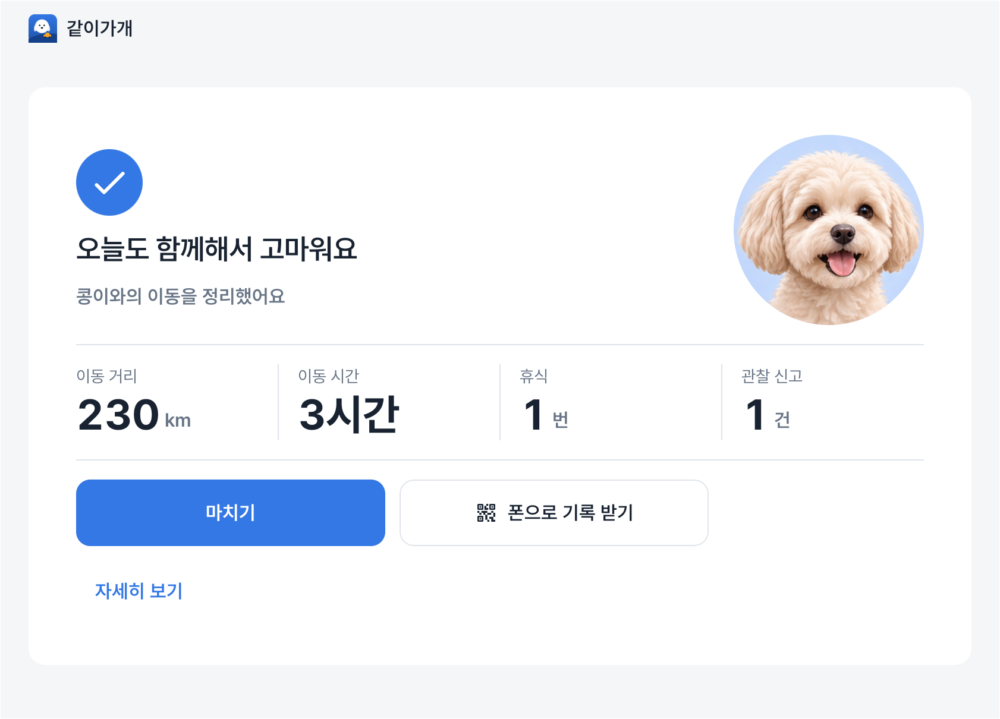<br><b>도착 요약</b><br>오늘 이동을 한눈에</td>
</tr>
<tr>
<td align="center" width="33%">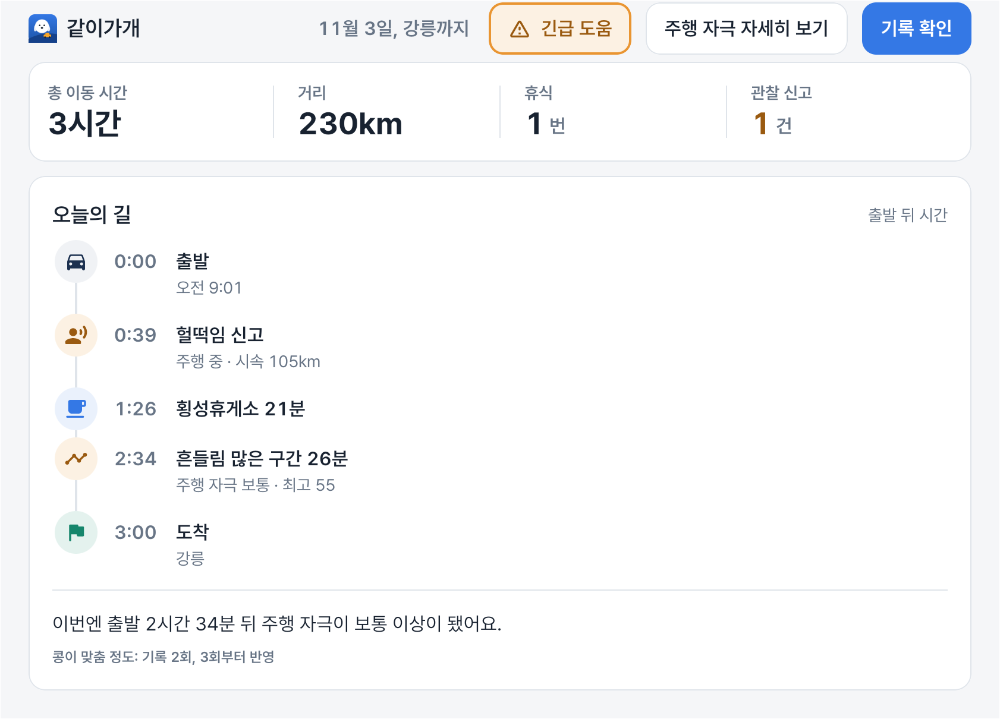<br><b>도착 리포트</b><br>시간 순서로 한 장에</td>
<td align="center" width="33%">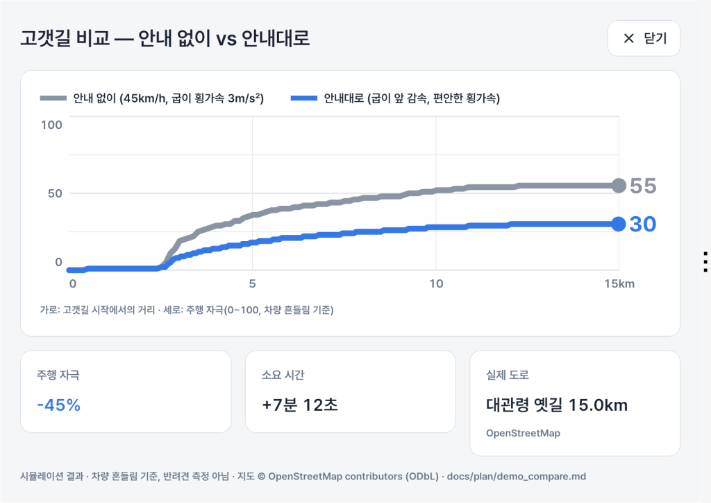<br><b>고갯길 비교</b><br>안내대로 달리면 흔들림 45% 감소</td>
<td align="center" width="33%">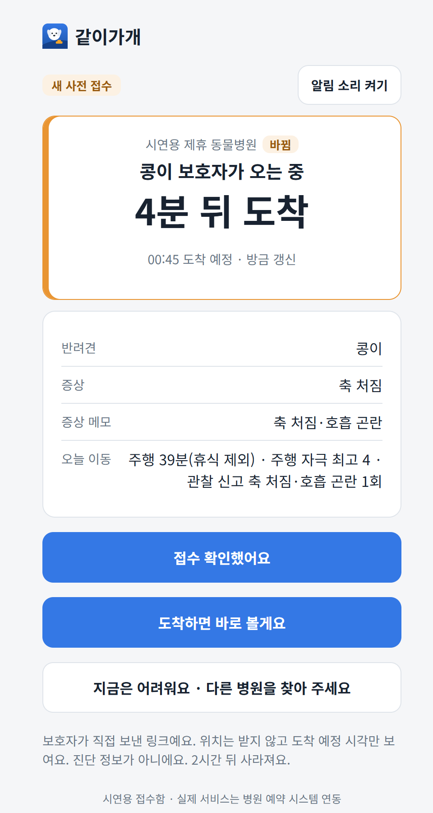<br><b>병원 접수함</b><br>병원 쪽에서 보는 사전 접수</td>
</tr>
</table>

<br>

## ▶️ 실행 방법

제출한 APK는 서버 없이 동작합니다.

1. Pleos Playground에서 **Pleos Connect Emulator 2.1.0** AVD를 만들고 실행합니다.
2. Releases에서 `gatigage-v1.0.0.apk`를 받아 설치합니다.
   ```powershell
   adb uninstall com.emop.pause
   adb install gatigage-v1.0.0.apk
   ```
3. 앱을 켜고 출발 전 화면에서 10초쯤 기다리면 **시연 주행 시작** 버튼이 나옵니다. 누르면 서울에서 강릉까지 가는 시연 주행이 시작됩니다.
4. 왼쪽 위 로고를 다섯 번 누르면 발표 패널이 열립니다. 원하는 장면으로 건너뛰거나, 음성 대신 응답을 넣을 수 있습니다.

| 항목 | 값 |
| --- | --- |
| 에뮬레이터 | Pleos Connect Emulator 2.1.0, Android 14, 2560×1440 |
| 앱 SDK | minSdk 28, targetSdk 34 |
| AVD 메모리 | 4096MB |
| 음성 | 에뮬레이터에는 마이크가 없어 8초 뒤 버튼으로 바뀝니다 |

반려견 동반 장소 327곳과 동물병원 5,063곳은 공공데이터를 앱에 넣어 두어서 서버 없이도 실제 이름으로 추천과 병원 안내가 나옵니다. 보호자 휴대폰 페이지와 병원 접수함은 서버가 있어야 해서 시연 영상으로 보여 드립니다.

<br>

## 🛠️ 기술 스택

- **App**
  
  
  
  
  
  
- **Vehicle**
  
  
  
  
- **Backend**
  
  
  
  
- **Database**
  
- **AI / LLM**
  
  
  
- **Data**
  
  
  
- **Infra / Test**
  
  
  
  
  

<br>

## 🏗️ 아키텍처

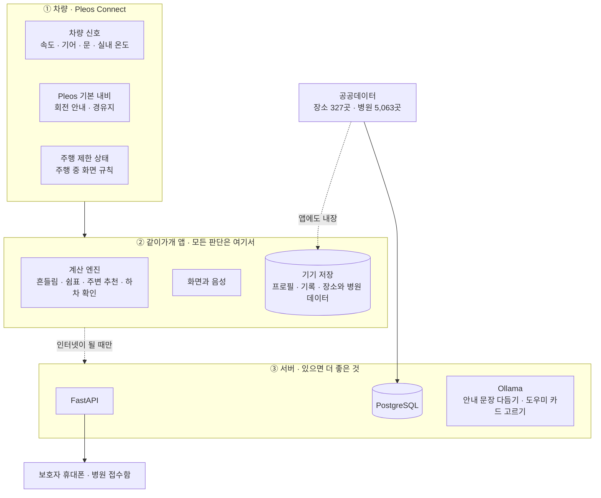

| 층 | 하는 일 | 없으면 |
| --- | --- | --- |
| ① 차량 | 신호와 길 안내를 앱에 줍니다 | 그 신호를 쓰는 기능만 꺼집니다 |
| ② 앱 | 흔들림 계산, 쉼표와 주변 추천, 하차 확인, 화면과 음성을 모두 맡습니다. 장소와 병원 데이터도 앱 안에 있습니다 | 없음 |
| ③ 서버 | 보호자 휴대폰 페이지, 병원 접수함, 데이터 갱신, 안내 문장 다듬기, 도우미가 규칙으로 못 고른 질문의 카드 고르기 | 앱의 내장 데이터와 기본 문장으로 계속 동작합니다. 도우미는 앱 안 규칙과 카드로 답합니다 |

<br>

## 🔄 요약 파이프라인

**흔들림 예보**

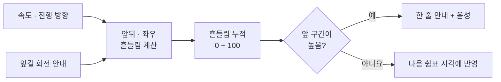

**이상 신고에서 병원까지**

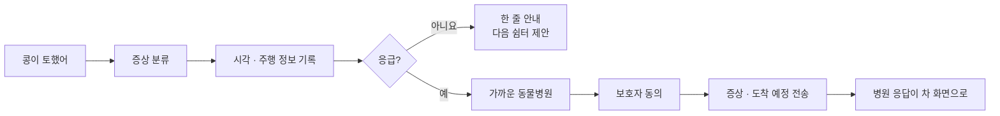

**주변 추천**

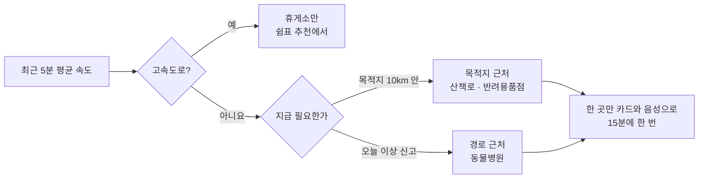

**정차부터 하차까지**

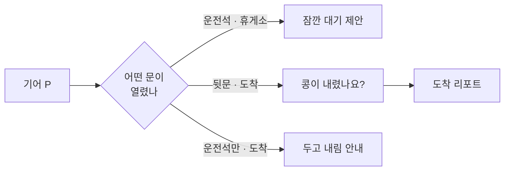

<br>

## 📁 폴더 구조

```
every-moment-of-pause
├─ app-android            차량 앱
│  ├─ app                 화면, 화면 상태, 시연 패널
│  ├─ core
│  │  ├─ vehicle          Pleos Vehicle SDK와 AAOS 차량 신호
│  │  ├─ navi             NaviHelper 연동
│  │  ├─ restriction      주행 제한 상태
│  │  └─ model            신호 모델과 잡음 처리
│  ├─ engine
│  │  ├─ motion           흔들림 계산과 예보
│  │  ├─ planner          반려견 맞춤 쉼표
│  │  ├─ pet              이상 신고, 긴급 분류, 문 신호, 하차 확인
│  │  ├─ fatigue          운전자 피로
│  │  └─ needs            배변 간격, 충전
│  ├─ voice               음성 인식과 안내
│  ├─ data                기기 저장, 내장 데이터
│  └─ sim                 시연 주행 재생
├─ server                 FastAPI 서버
│  ├─ app                 API, 데이터 적재, 보호자·병원 페이지
│  └─ tests
├─ content/care           돌봄 카드 12장
├─ scenarios              시연 주행 시나리오, 고갯길 경로
├─ scripts                시연 점검, 리허설, 캡처, 녹화
└─ docs                   설계 문서, 스토어 제출 서류, 화면
```

<br>

## 📊 검증

- 자동 테스트 앱 382개, 서버 102개 통과
- 콩이 도우미 평가 85문항: 분류 85/85, 응급 우선 20/20, 금지 내용 0건, 2단계 응답 p50 0.8초 ([docs/plan/helper_eval.md](docs/plan/helper_eval.md))
- 발표 리허설 3회 연속 통과, 각 70초 안팎
- 장면을 20번 연속 건너뛴 뒤에도 멈춤 없이 동작
- 돌봄 카드 12장은 Merck Veterinary Manual, RSPCA 공개 자료와 문장 단위로 대조했습니다. 수의사 감수는 받지 않았습니다. 도우미 초안 카드 14장은 검수 전이라 릴리스 빌드에 들어가지 않습니다.
- Pleos App Market 제출 서류를 `docs/store`에 준비했습니다. 개인정보 처리방침, 데이터 처리 내역, 운전자 주의분산 점검표, 스토어 문구가 들어 있습니다.
- 다음 단계: 운전대 음성 버튼 연동. AAOS에서는 이 키가 시스템 어시스턴트로 가서 일반 앱이 받을 수 없습니다(docs/BLOCKED.md). 지금은 주행 패널의 [눌러서 말하기]로 대신합니다.

<br>

## 📄 데이터 출처와 라이선스

- 반려동물 동반 장소: 한국관광공사 반려동물 동반여행 서비스, 공공데이터포털 이용허락범위 제한 없음
- 동물병원: 행정안전부 동물병원 인허가 데이터, 공공데이터포털 이용허락범위 제한 없음
- 휴게소: 한국도로공사
- 고갯길 경로: © OpenStreetMap contributors, ODbL 1.0
- 글꼴: Pretendard, SIL OFL 1.1
- 이 저장소의 코드는 공모전 심사와 열람 목적으로만 쓸 수 있습니다. 자세한 내용은 [LICENSE](LICENSE)를 봐 주세요.
- 문의는 이 저장소의 Issues 탭으로 받습니다.
