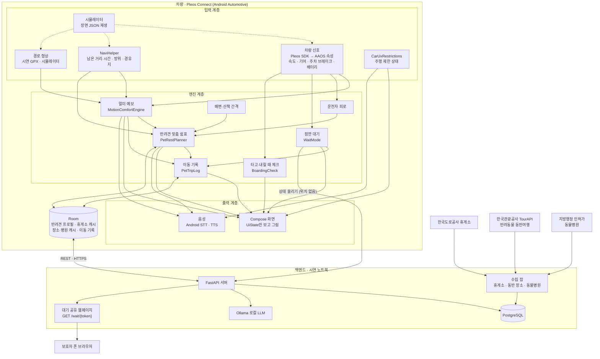
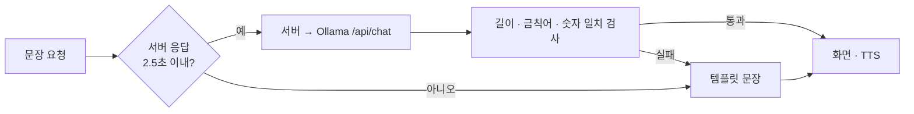
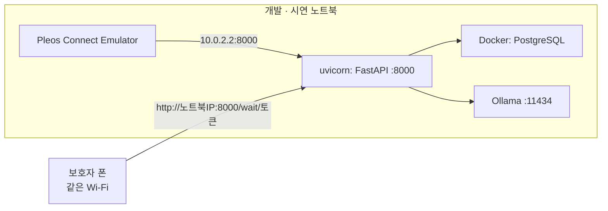
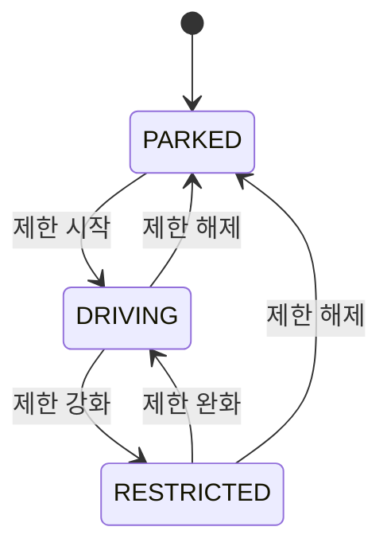
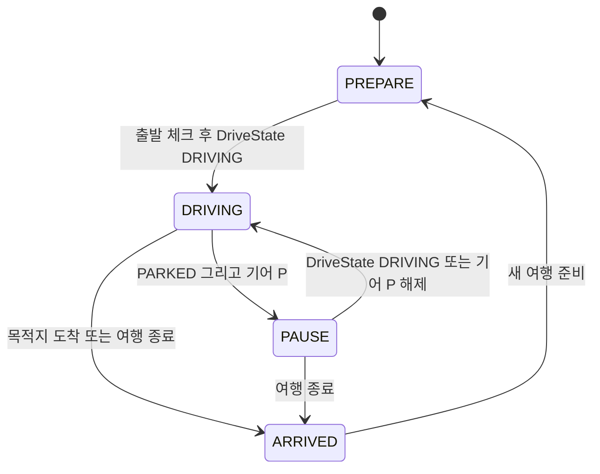

# 아키텍처 — 같이가개 (반려견과 차로 가는 모든 순간)

기능 범위의 기준은 [docs/plan/CONCEPT.md](docs/plan/CONCEPT.md), 쉼표에서 무엇을 가져왔는지는 [docs/plan/REUSE_MAP.md](docs/plan/REUSE_MAP.md), SDK로 무엇을 받을 수 있는지는 [docs/plan/sdk_check.md](docs/plan/sdk_check.md)에 있다.

## 1. 설계 원칙

1. **판단은 차 안에서.** 멀미 지수, 휴식 추천, 대기 모드 경과, 도착 체크는 모두 앱 안에서 계산한다. 서버가 끊겨도 핵심 기능(F1·F2·F3 차 화면·F6·F7)은 동작한다.
2. **서버는 데이터와 공유만.** 서버는 휴게소·반려동물 동반 장소·동물병원 데이터를 정제해 내려주고, 대기 모드 상태를 보호자 폰 웹페이지로 보여 주고, 기록 요약 문장을 다듬는다. LLM이 실패하면 템플릿 문장을 쓴다.
3. **SDK는 인터페이스 뒤에.** Vehicle·NaviHelper·AAOS 속성·STT·TTS를 인터페이스로 감싸고, 확인한 시그니처만 쓴다(sdk_check.md). 승인 전 SDK, 차종별 미지원 신호, 시뮬레이터를 같은 코드로 처리한다.
4. **주행 중에는 음성, 정차 중에는 화면.** `CarUxRestrictions` 상태가 모든 UI의 최상위 분기다. 대기 모드의 바깥 사람용 화면은 P단에서만.
5. **정직한 표현.** 멀미 지수는 의학적 진단이 아니라 "주의 예보"다. 계수는 문헌 기반 가정값이며 근거를 [docs/plan/motion_model.md](docs/plan/motion_model.md)에 적는다. 샘플 데이터는 화면에 "샘플"로 표시한다.
6. **시연은 절대 실패하지 않게.** 시뮬레이터가 실제 SDK와 같은 인터페이스로 값을 주입하고, 노트북 한 대에서 앱·서버·LLM이 모두 돈다.

## 2. 전체 구성도

## 3. 구성요소 설명

### 3.1 차량 앱 (app-android)

applicationId·패키지는 쉼표 때의 `com.emop.pause`를 그대로 쓴다(빌드 위험). 화면 표시 이름만 "같이가개".

| 모듈 | 책임 | 주요 클래스 |
| --- | --- | --- |
| `core:model` | 1초 단위 신호(`SignalSample`: 속도·기어·주차 브레이크·배터리·충전·공조·**방위**), 신호 출처 합치기, 잡음 처리 | `SignalSample`, `SignalMerge`, `SignalSmoother` |
| `core:vehicle` | Pleos Vehicle SDK → AAOS CarPropertyManager 순으로 신호별 수급 | `PleosVehicleSource`, `AaosPropertySource` |
| `core:navi` | 남은 거리·시간, 현재 위치 방위, 경유지 추가 (NaviHelper 3.0.5) | `NaviSource`, `PleosNaviSource` |
| `core:restriction` | `CarUxRestrictions` → `DriveState` (PARKED / DRIVING / RESTRICTED) | `DriveStateRepository` |
| `core:uistate` | 화면 계약: 화면별 상태·이벤트·주행 중 규칙 ([docs/ui_contract.md](docs/ui_contract.md)) | `AppUiState`, `Screen`, `UiEvent`, `Fixtures` |
| `engine:motion` | **F1 멀미 예보**: 종·횡가속 추정 → 0.02~0.5Hz 대역(수평 흔들림, motion_model.md §3) → 누적량(MSDV 단순화) → 프로필 보정 → 0~100 지수, 앞 구간 예보 | `MotionComfortEngine`, `MotionConstants`, `RouteShape`, `MotionPhrases` |
| `engine:pet` | **F3 대기 모드**, **F6 타고·내릴 때 체크**, **F7 이동 기록 패턴**, 이름 조사 (`PetProfile`은 `core:model`) | `WaitMode`, `BoardingCheck`, `PetTripLog`, `Josa` |
| `engine:fatigue` | 운전자 피로 (F2의 요인 하나) | `FatigueEngine` |
| `engine:needs` | 반려견 배변·산책 간격(프로필 값), 충전 니즈 | `NeedsEngine` |
| `engine:planner` | **F2 반려견 맞춤 쉼표**: 멀미 누적·주행 시간·배변 간격·운전자 피로·반려견 시설 가중치로 휴게소 1곳 + 이유 1~2개, 히스테리시스·쿨다운 | `PetRestPlanner`, `ScoringPolicy`, `SuggestionPolicy`, `RestPhrases` |
| `engine:pause` | 쉼표에서 할 일(산책·물·배변·스트레칭) | `PauseCurator` |
| `voice` | Android 기본 STT/TTS, 우선순위 큐(안전 > 제안 > 안내 > 배경), "응/나중에/여기서 쉴게요/잠깐 다녀올게" 의도 | `SpeechQueue`, `VoiceIntent`, `ReplyIntent` |
| `data` | Room 두 개: `pause.db`(휴게소 캐시, 스키마가 바뀌면 지움)와 `pet.db`(반려견 프로필·이동 기록), Retrofit, 오프라인 내장 데이터 | `RestStopRepository`, `RoomPetStore`, `PlaceRepository` |
| `sim` | 장면(depart/highway/rest_stop/wait/mountain_road/arrive) JSON 재생, 방위·경로 형상 포함 | `ScenarioPlayer` |
| `app` | ViewModel·화면 선택(`ScreenRouter`)·`AppModeReducer`·`TripCoordinator`(엔진 묶음과 음성 흐름) | `MainViewModel`, `TripBrain`, `TripCoordinator` |

**신호 수급 전략.** 차종마다 지원 신호가 다르므로 엔진은 nullable 신호를 받고, 값이 없는 요인은 빼고 재정규화한다. 멀미 엔진은 방위가 없으면 경로 형상(곡률)으로, 그것도 없으면 종방향 가속만으로 계산하고 화면에 "곡선 정보 없음"을 표시한다.

### 3.2 백엔드 (server)

| 구성 | 책임 |
| --- | --- |
| `api/reststops`·`jobs/ingest_reststops` | 휴게소·졸음쉼터·반려견 놀이터 (F2). `EX_API_KEY`가 없으면 `sample_reststops.json` |
| `api/places`·`jobs/ingest_pet_places` | 반려동물 동반 식당·카페·숙소·관광지 (F4). 한국관광공사 TourAPI. `TOUR_API_KEY`(환경 변수)가 없으면 `data/sample_pet_places.json`("샘플" 표시). 경로 버퍼 검색 |
| `api/vets`·`jobs/load_vets` | 동물병원 (F5). 공공데이터 인허가 파일(`data/raw/`)을 적재, 없으면 `sample_vets.json` |
| `api/wait` | 대기 모드 공유 (F3). 앱이 상태를 올리면 보호자 폰이 `GET /wait/{token}` 웹페이지(큰 글자, 5초 자동 새로고침)로 본다. 토큰 무작위, 2시간 만료, **위치는 받지 않음** |
| `api/llm` | 이동 기록 요약 문장(F7). 타임아웃 2.5초, 실패 시 템플릿 |
| `api/trips` | 여행 시작·종료, 이벤트 일괄 업로드, 리포트 집계 (선택 업로드) |
| `jobs/cleanup` | 보관 기간 정리(여행 90일, LLM 기록 30일, 대기 공유 만료 후 1일, 기기 180일) |

### 3.3 LLM 계층

음성은 Android `SpeechRecognizer`/`TextToSpeech`가 1순위이고 Pleos STT/TTS가 Playground에 열리면 교체한다. 문장은 서버 경유 Ollama를 쓴다(쉼표와 같음).

- LLM은 **휴게소 제안 문장과 이동 기록 요약**에만 쓴다. 멀미 예보·안전 문구·"내렸나요?"는 템플릿만 (안전 문구에 지어낸 말이 섞이지 않게).
- 모델: `OLLAMA_MODEL=gemma4:12b`, `POST /api/chat`, `think=false`, `keep_alive=30m`, `num_predict=60`, `temperature=0.3`, 서버 시작 시 warm-up.

## 4. 배포 구성

- **시연:** 앱·서버·DB·LLM을 한 노트북에서. 보호자 폰은 같은 Wi-Fi에서 노트북 IP로 대기 페이지를 연다(QR은 차 화면에 표시).
- **오프라인:** 네트워크가 없어도 F1·F2·F6·F7과 대기 모드 차 화면은 동작한다. 폰 공유만 "연결 안 됨"으로 표시.

## 5. 상태 모델 — DriveState와 AppMode

- **DriveState** (`core:restriction`): `CarUxRestrictions`에서만 나온다. **어디까지 허용할지**.
- **AppMode** (`AppModeReducer`): DriveState + 기어 + 충전 상태 + 여행 진행 여부. **무엇을 보여줄지**.
- **최우선 규칙:** DriveState가 DRIVING/RESTRICTED면 AppMode와 상관없이 즉시 주행 UI. 대기 모드도 즉시 끝난다.

### 5.1 DriveState

| DriveState | 허용 범위 | 음성 |
| --- | --- | --- |
| PARKED | 전체 화면, 설정, 기록, 애니메이션(정차 화면만) | 자유 |
| DRIVING | 텍스트 2줄 이하, 버튼 2개 + 음성 힌트, 스크롤·키보드·영상·자동 애니메이션 금지 | 제안·응답·멀미 예보 |
| RESTRICTED | 가장 급한 한 줄만, 터치 최소화 | 제안·응답·멀미 예보 |

### 5.2 AppMode

| AppMode | 화면 |
| --- | --- |
| PREPARE | 출발 체크(반려견 프로필·하네스·물·배변봉투), 오늘의 쉼표 계획 |
| DRIVING | 주행 글랜스: 멀미 예보 한 줄 + 다음 쉼표 |
| PAUSE | 쉼표 화면(산책·물·배변). "잠깐 다녀올게" → **대기 모드**(PAUSE의 하위 상태, 차 화면이 바깥 사람용 안내로 바뀜) |
| ARRIVED | 도착 체크("콩이 내렸나요?") → 이동 기록 |

경계 조건 (쉼표에서 그대로):
- 여행 중 PARKED인데 기어가 P가 아님(신호 대기) → DRIVING 유지.
- 기어 미지원 차종 → PARKED + 속도 0이 60초 이상이면 PAUSE, 주차 브레이크가 걸리면 즉시 PAUSE.
- **대기 모드**는 PAUSE이고 사용자가 시작했을 때만 켜진다. 기어가 P에서 벗어나거나 DriveState가 PARKED가 아니면 즉시 끝난다(F3).
- **도착 체크**는 ARRIVED 진입, 또는 여행 중 P단 + 주행 종료 판단(기어 P가 `BoardingCheck.END_HOLD_SEC` 이상 + 목적지 300m 안)일 때 뜬다(F6).

## 6. 보안·개인정보

| 항목 | 정책 |
| --- | --- |
| 식별 | 계정 없음. 익명 기기 토큰, 서버에는 해시만 |
| 반려견 프로필 | 기기 Room에만 저장, **서버 전송 안 함** (이름·체급·나이·멀미 성향·배변 간격) |
| 위치 | 경로 좌표는 장소·휴게소 조회 요청에만 쓰고 저장하지 않음. **대기 공유에는 위치를 보내지 않음** |
| 대기 공유 토큰 | 무작위 128비트, 2시간 만료, 만료 후 1일 안에 삭제. 페이지에는 경과 시간·배터리%·실내 온도(있을 때)·제한 시간만 |
| LLM 로그 | 원문 저장 안 함. 종류·지연시간·폴백 여부만 |
| 표현 | 멀미 지수·실내 온도는 "참고 표시". 의학적 진단·안전 보장 문구를 쓰지 않음 |

## 7. 성능 목표

| 지표 | 목표 |
| --- | --- |
| 멀미 지수 갱신 | 1초 (예보 재계산 10초) |
| 휴게소 추천 계산 | 기기에서 100ms 이내 |
| 대기 공유 갱신 | 앱 → 서버 10초마다, 폰 페이지 5초마다 새로고침 |
| 제안 문장 생성 | 2.5초 이내, 초과 시 템플릿 |
| 오프라인 동작 | 출발 시 경로 휴게소·장소·병원 캐시 후 서버 없이 동작 |
