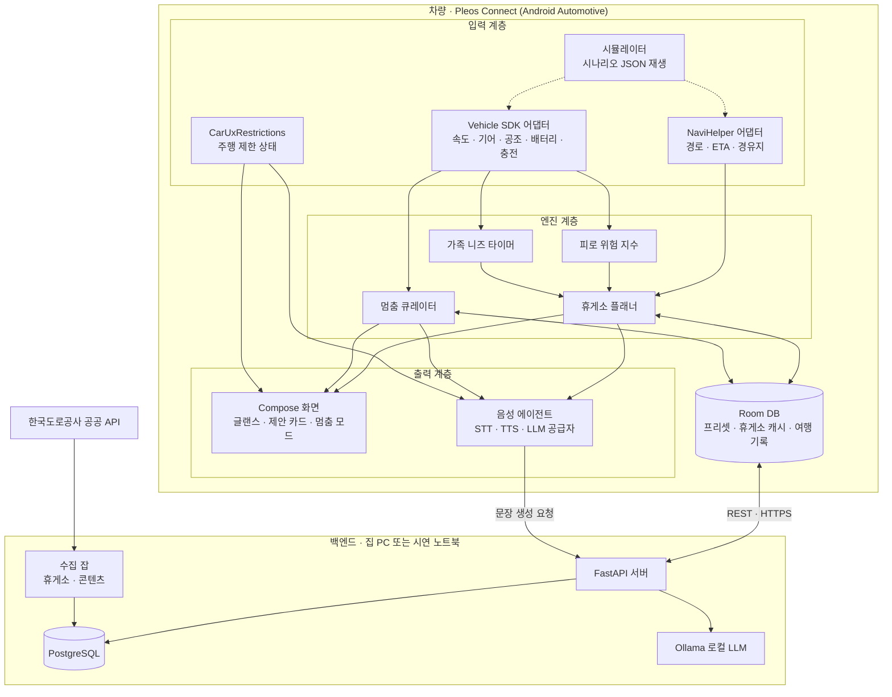
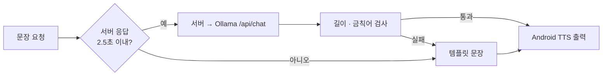
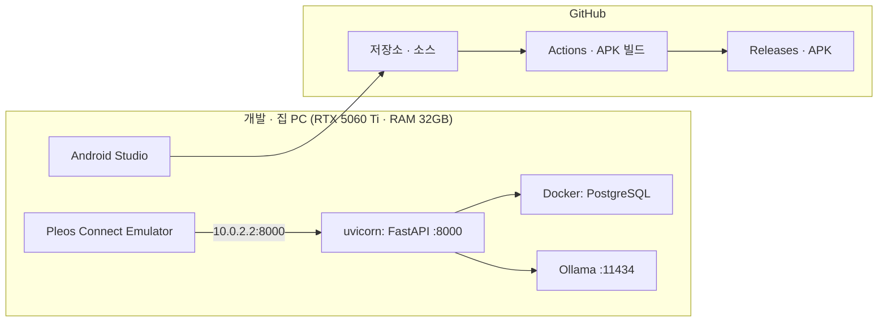
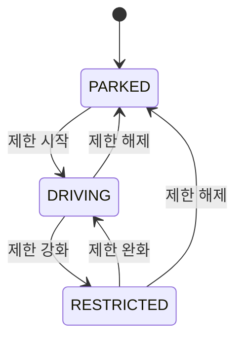
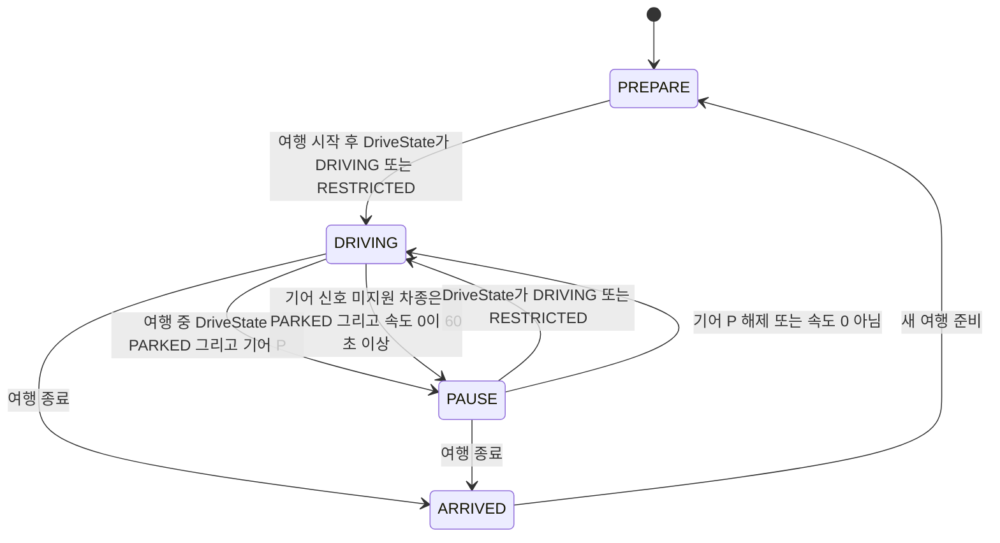

# 아키텍처 — 쉼표 (멈춤의 모든 순간)

## 1. 설계 원칙

1. **판단은 차 안에서.** 피로 지수, 니즈 타이머, 휴게소 점수화, 멈춤 큐레이션은 모두 앱 안에서 계산한다. 서버가 끊겨도 핵심 기능은 동작한다.
2. **서버는 데이터와 문장만.** 서버는 휴게소·콘텐츠 데이터를 정제해 내려주고, LLM으로 제안 문장을 다듬는다. LLM이 실패하면 템플릿 문장을 쓴다.
3. **SDK는 인터페이스 뒤에.** Vehicle·NaviHelper·STT·TTS·LLM 모두 인터페이스로 감싸고 구현을 갈아끼운다. 승인 전 SDK, 차종별 미지원 신호, 시뮬레이터를 같은 코드로 처리한다.
4. **주행 중에는 음성, 정차 중에는 화면.** `CarUxRestrictions` 상태가 모든 UI의 최상위 분기다.
5. **시연은 절대 실패하지 않게.** 시뮬레이터가 실제 SDK와 같은 인터페이스로 값을 주입하고, 노트북 한 대에서 앱·서버·LLM이 모두 돈다.

## 2. 전체 구성도

## 3. 구성요소 설명

### 3.1 차량 앱 (app-android)

| 모듈 | 책임 | 주요 클래스(예정) |
| --- | --- | --- |
| `core:vehicle` | Vehicle SDK 호출, `checkXXXCapabilities`로 지원 여부 확인, 1초 단위 `SignalSample` Flow 제공 | `VehicleSource`, `PleosVehicleSource`, `SimVehicleSource` |
| `core:navi` | 경로·ETA·남은 거리 조회, 경유지 추가 | `NaviSource`, `PleosNaviSource`, `SimNaviSource` |
| `core:restriction` | `CarUxRestrictionsManager` 구독 → `DriveState` (PARKED / DRIVING / RESTRICTED). **CarUxRestrictions만** 입력으로 쓴다 | `DriveStateRepository` |
| `engine:fatigue` | 연속 주행, 시간대, 단조로움, 난방·내기순환, 야간, 수면 시간 입력으로 0~100 점수 + 상위 기여 요인 3개 | `FatigueEngine`, `FatigueRules` |
| `engine:needs` | 동승자별 다음 필요 시각(화장실·수유·펫 산책·충전) 추적 | `NeedsEngine` |
| `engine:planner` | 경로상 후보 휴게소를 도착 시간·피로·니즈·편의시설로 점수화, 추천 1개 + 이유 생성 | `RestPlanner`, `ScoringPolicy` |
| `engine:pause` | 정차 원인(휴게소·충전·졸음쉼터)과 남은 시간으로 멈춤 활동 편성 | `PauseCurator` |
| `voice` | STT/TTS/LLM 공급자 체인. **현재는 Android 기본 STT/TTS + Ollama(서버 경유)가 1순위**, 실패 시 템플릿. Pleos STT/TTS가 Playground에 열리면 교체 (§3.3) | `SpeechProvider`, `PhraseProvider` |
| `data` | Room DAO, Retrofit 클라이언트, 오프라인 캐시 정책 | `RestStopRepository`, `TripRepository` |
| `sim` | 시나리오 JSON의 시간축 이벤트를 배속 재생 | `ScenarioPlayer` |
| `app` | 화면, ViewModel, 내비게이션 그래프, 테마(디자인 토큰). `AppModeReducer`가 DriveState + 기어 + 충전 상태 + 여행 진행 여부로 `AppMode`(PREPARE / DRIVING / PAUSE / ARRIVED)를 계산 (§5) | `AppModeReducer`, `GlanceScreen`, `SuggestionCard`, `PauseScreen` |

**신호 수급 전략.** 차종마다 지원 신호가 다르므로 엔진은 `Signal?` 타입을 받고, 값이 없는 항목은 가중치를 0으로 두고 나머지를 재정규화한다. 화면에는 "이 차에서 사용 중인 신호" 목록을 정차 화면 설정에 노출한다.

### 3.2 백엔드 (server)

| 구성 | 책임 |
| --- | --- |
| `api/reststops` | 경로 좌표 묶음을 받아 진행 방향 앞쪽 휴게소·졸음쉼터 목록과 편의시설 반환 |
| `api/content` | 라디오 에피소드·원정대 미션 조회, 목표 시간에 맞춘 플레이리스트 편성 |
| `api/llm` | 제안 문장, "아직 멀었어?" 답변, 여행 리포트 요약 생성. 타임아웃 2.5초, 실패 시 템플릿 |
| `api/trips` | 여행 시작·종료, 이벤트 일괄 업로드, 리포트 집계 |
| `jobs/ingest_reststops` | 도로공사 API → 정규화 → `rest_stops`, `rest_stop_facilities` 적재 (일 1회). **`EX_API_KEY`가 비어 있으면** 외부 호출 없이 `server/app/data/sample_reststops.json`(도로공사 응답과 같은 형식의 샘플)을 읽어 같은 정규화 경로로 적재하고, 로그에 `source=sample`을 남긴다 (M2) |
| `jobs/seed_content` | `content/*.json` (사람이 검수한 아이용 콘텐츠) → DB 적재 |

**아이용 콘텐츠는 실시간 생성하지 않는다.** LLM이 사실을 지어낼 위험이 있으므로 속담·상식 라디오는 미리 생성 → 사람이 검수 → DB에 저장한 것만 재생한다. 실시간 LLM은 "아직 멀었어?" 같은 짧은 연결 문장에만 쓴다.

### 3.3 LLM 계층

**현재 1순위 (2026-10-27 기준): Android 기본 STT/TTS + Ollama.** Pleos Playground에서 지금 쓸 수 있는 것은 Vehicle State(11개 항목)와 NaviHelper뿐이다. TTS·STT·FusedLocation·Vehicle Control은 Coming Soon이고, LLM은 목록에 없다 (Playground v2.6.0 릴리스 노트에서 LLM SDK 중단). 그래서 음성은 Android `SpeechRecognizer`/`TextToSpeech`가 1순위이고 Pleos STT/TTS가 열리면 그 공급자로 교체한다. 문장은 서버 경유 Ollama를 쓴다.

- 출력 규칙: 운전 중 문장은 **최대 2문장, 숫자·장소 먼저**. 서버에서 길이·금칙어 검사 후 반환.
- 모델: `OLLAMA_MODEL=gemma4:12b` (16GB VRAM 기준).
- 호출: Ollama 네이티브 `POST /api/chat`, `stream=false`, `think=false`, `keep_alive="30m"`, `options.num_predict=60`(`OLLAMA_NUM_PREDICT`), `options.temperature=0.3`. OpenAI 호환 API(`/v1/chat/completions`)는 `think` 옵션 지원이 불확실해서 1순위로 쓰지 않는다.
- 실측 (2026-10-27): 모델이 올라간 상태에서 2.58초, 100% GPU. 2.5초 목표에 맞추려고 `num_predict=60`, `temperature=0.3`으로 출력을 묶는다.
- **Warm-up (M2).** 모델이 메모리에 없으면 첫 응답이 2.5초를 훨씬 넘는다. 서버 시작 시(FastAPI lifespan) `POST /api/chat`에 `messages=[]`, `keep_alive=OLLAMA_KEEP_ALIVE`로 한 번 보내 모델을 미리 올린다. 백그라운드 태스크로 돌려 서버 기동을 막지 않고, 실패하면 경고 로그만 남긴다(`/health`가 `llm` 상태로 드러냄). 이후에는 `keep_alive=30m`이 상주를 유지한다.

## 4. 배포 구성

- **개발/시연:** 앱·서버·DB·LLM을 한 PC에서 실행. 에뮬레이터는 `10.0.2.2`로 호스트 PC에 접근.
- **PT 현장:** 같은 구성을 노트북에 올려 **오프라인 시연**. 네트워크가 없어도 휴게소 캐시와 템플릿 문장으로 동작.
- **실차 시연이 필요할 경우:** 서버를 HTTPS 터널로 공개하거나, 서버 없이 앱 내장 데이터만으로 동작하는 `offline` 빌드 변형 사용.
- **선택:** 학교 RTX 5090은 11/15 이후 더 큰 모델 비교·피로 모델 v2 학습용.

## 5. 상태 모델 — DriveState와 AppMode

상태는 두 개로 나눈다.

- **DriveState** (`core:restriction`): `CarUxRestrictions`에서만 나오는 상태. 기어·충전 같은 차량 신호는 보지 않는다. **어디까지 허용할지**를 정한다.
- **AppMode** (`app` 모듈의 `AppModeReducer`): 화면을 고르는 상태. 입력은 DriveState + 기어 + 충전 상태 + 여행 진행 여부. **무엇을 보여줄지**를 정한다.

**최우선 규칙:** DriveState가 DRIVING이나 RESTRICTED가 되면 AppMode와 상관없이 즉시 주행 UI로 전환한다. 멈춤 화면의 애니메이션·소리도 즉시 중단한다.

### 5.1 DriveState

| DriveState | 허용 범위 | 음성 |
| --- | --- | --- |
| PARKED | 전체 화면, 설정, 리포트, 애니메이션 | 자유 |
| DRIVING | 글랜스 카드 1장(2줄), 큰 버튼 1개, 키보드·영상·자동 애니메이션 금지 | 제안·응답 |
| RESTRICTED | 글랜스 카드만, 터치 최소화 | 제안·응답 |

### 5.2 AppMode

| AppMode | 조건 | 화면 |
| --- | --- | --- |
| PREPARE | 여행 시작 전, DriveState = PARKED | 출발 준비(프리셋·수면 한마디·휴식 계획) |
| DRIVING | DriveState = DRIVING 또는 RESTRICTED | 주행 글랜스, 제안 카드 |
| PAUSE | 여행 중, DriveState = PARKED, 기어 P (기어 신호 미지원 차종은 속도 0이 60초 이상). 원인: 충전 중이면 `charging`, 아니면 `rest` | 멈춤 화면(벽난로·미션·타이머), 애니메이션 허용 |
| ARRIVED | 여행 종료 후 | 여행 리포트 |

경계 조건 (확정, 2026-10-27):
- 여행 중 DriveState = PARKED인데 기어가 P가 아님(신호 대기 등) → **DRIVING 유지** (안전 쪽).
- 기어 신호를 지원하지 않는 차종 → DriveState = PARKED이고 **속도 0이 60초 이상** 이어지면 PAUSE. 60초가 되기 전에 속도가 0이 아니게 되면 타이머를 0으로 되돌린다. PAUSE 중 속도가 0이 아니게 되면 DRIVING.
- 여행 전·종료 후라도 DriveState가 DRIVING/RESTRICTED면 주행 UI가 우선한다 (최우선 규칙).

## 6. 보안·개인정보

| 항목 | 정책 |
| --- | --- |
| 식별 | 계정 없음. 최초 실행 시 익명 기기 토큰 발급, 서버에는 해시만 저장 |
| 위치 | 경로 좌표는 휴게소 조회 요청에만 사용하고 저장하지 않음. 여행 이벤트에는 휴게소 ID만 기록 |
| 수면·동승자 정보 | 기기 Room DB에만 저장, 서버 전송 안 함 |
| LLM 로그 | 원문 저장 안 함. 종류·지연시간·폴백 여부만 기록 |
| 권한 | Pleos App Market과 사전 협의된 권한만 매니페스트에 선언 |

## 7. 성능 목표

| 지표 | 목표 |
| --- | --- |
| 피로 지수 갱신 주기 | 10초 (신호 수집은 1초) |
| 휴게소 추천 계산 | 기기에서 100ms 이내 |
| 제안 문장 생성 | 2.5초 이내, 초과 시 템플릿 |
| 앱 메모리 | 200MB 이하 |
| 오프라인 동작 | 출발 시 경로 전체 휴게소 캐시 후 서버 없이 추천 가능 |
