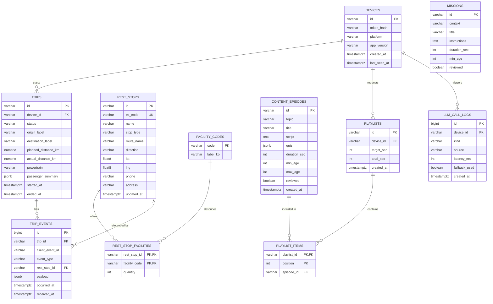
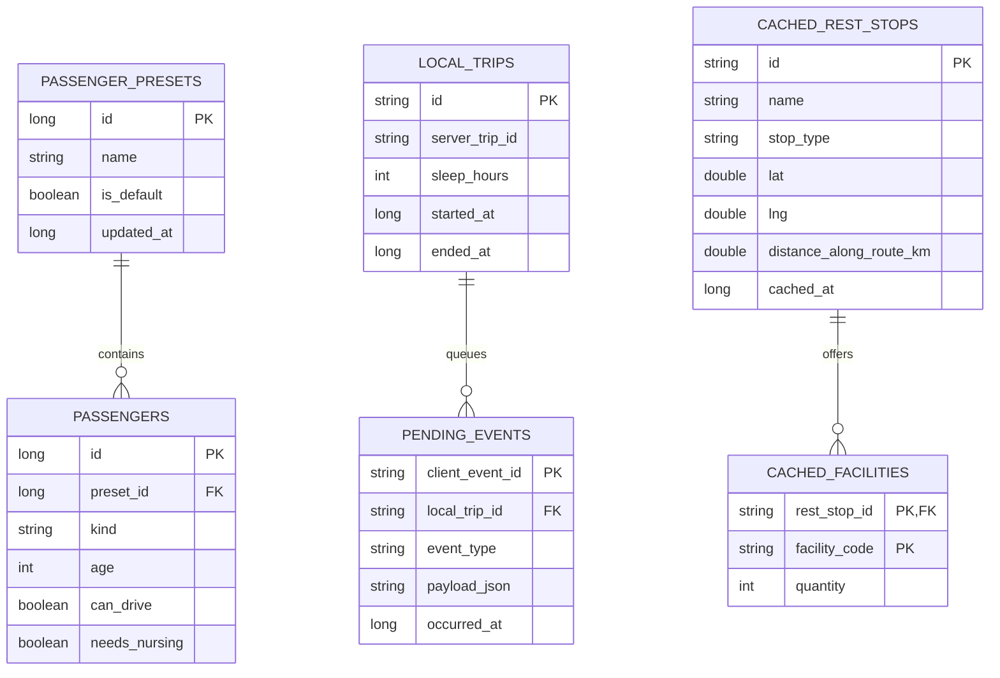

# DB 스키마 — 쉼표 (멈춤의 모든 순간)

데이터는 두 곳에 나뉜다. **서버 PostgreSQL**은 공용 데이터(휴게소·콘텐츠)와 익명 여행 이벤트를, **기기 Room DB**는 개인 데이터(동승자 프리셋·수면 시간)와 오프라인 캐시를 맡는다. 개인 데이터는 서버로 보내지 않는다.

**테스트 정책.** 서버 DB 테스트는 두 층으로 나눈다. 마이그레이션 검증과 통합 테스트는 PostgreSQL 16에서 돌린다(로컬은 `docker compose`, CI는 GitHub Actions service container). 아래 DDL의 `JSONB`·`BIGSERIAL`·`TIMESTAMPTZ`·`'{}'::jsonb`는 PostgreSQL 전용이므로, Alembic 마이그레이션은 PostgreSQL에서만 검증한다. 단위 테스트는 SQLite in-memory에서 돌리며, SQLAlchemy 모델은 `JSON().with_variant(JSONB(), "postgresql")`, `BigInteger().with_variant(Integer, "sqlite")`처럼 방언별 타입을 쓴다. PostgreSQL 전용 테스트는 `@pytest.mark.pg` 마커로 구분하고, DB에 연결할 수 없으면 skip한다.

## 1. 서버 ERD (PostgreSQL 16)



`MISSIONS`는 다른 테이블과 관계가 없는 독립 콘텐츠 테이블이다.

### 테이블 설명

| 테이블 | 용도 | 비고 |
| --- | --- | --- |
| `devices` | 익명 기기 | 토큰 원문은 저장하지 않음 |
| `rest_stops` | 휴게소·졸음쉼터 | `stop_type`: `service_area` · `drowsy_shelter`, 도로공사 코드 `ex_code` 고유 |
| `facility_codes` | 편의시설 코드표 | `nursing_room`, `kids_zone`, `pet_zone`, `ev_fast`, `ev_slow`, `shower`, `accessible_toilet` 등 |
| `rest_stop_facilities` | 휴게소별 편의시설 | 충전기는 `quantity`에 대수 |
| `content_episodes` | 아이 라디오 | `reviewed = true`만 서비스 |
| `missions` | 원정대 미션 | `context`: `rest_stop` · `charging` |
| `playlists`, `playlist_items` | 편성 결과 | 리포트·재생 기록용 |
| `trips` | 여행 단위 | 동승자는 인원 수만(`{"adults","children","pets"}` 정수). 나이·이름·반려동물 종류는 받지 않는다 (2026-10-29) |
| `trip_events` | 여행 중 이벤트 | `(trip_id, client_event_id)` 고유로 중복 방지 |
| `llm_call_logs` | LLM 품질 모니터링 | 프롬프트·응답 원문 저장 안 함 |

## 2. DDL 초안 (PostgreSQL)

```sql
-- 기기
CREATE TABLE devices (
    id            VARCHAR(32) PRIMARY KEY,
    token_hash    VARCHAR(128) NOT NULL,
    platform      VARCHAR(32)  NOT NULL,
    app_version   VARCHAR(16)  NOT NULL,
    created_at    TIMESTAMPTZ  NOT NULL DEFAULT now(),
    last_seen_at  TIMESTAMPTZ  NOT NULL DEFAULT now()
);

-- 휴게소
CREATE TABLE rest_stops (
    id          VARCHAR(32)  PRIMARY KEY,
    ex_code     VARCHAR(32)  NOT NULL UNIQUE,
    name        VARCHAR(64)  NOT NULL,
    stop_type   VARCHAR(16)  NOT NULL CHECK (stop_type IN ('service_area', 'drowsy_shelter')),
    route_name  VARCHAR(64)  NOT NULL,
    direction   VARCHAR(32)  NOT NULL,
    lat         DOUBLE PRECISION NOT NULL,
    lng         DOUBLE PRECISION NOT NULL,
    phone       VARCHAR(32),
    address     VARCHAR(255),
    updated_at  TIMESTAMPTZ  NOT NULL DEFAULT now()
);
CREATE INDEX idx_rest_stops_route ON rest_stops (route_name, direction);
CREATE INDEX idx_rest_stops_latlng ON rest_stops (lat, lng);

CREATE TABLE facility_codes (
    code      VARCHAR(32) PRIMARY KEY,
    label_ko  VARCHAR(64) NOT NULL
);

CREATE TABLE rest_stop_facilities (
    rest_stop_id   VARCHAR(32) NOT NULL REFERENCES rest_stops(id) ON DELETE CASCADE,
    facility_code  VARCHAR(32) NOT NULL REFERENCES facility_codes(code),
    quantity       INTEGER     NOT NULL DEFAULT 1 CHECK (quantity >= 0),
    PRIMARY KEY (rest_stop_id, facility_code)
);

-- 콘텐츠
CREATE TABLE content_episodes (
    id            VARCHAR(32)  PRIMARY KEY,
    topic         VARCHAR(32)  NOT NULL CHECK (topic IN ('proverb', 'common_sense', 'safety', 'manners')),
    title         VARCHAR(128) NOT NULL,
    script        TEXT         NOT NULL,
    quiz          JSONB,
    duration_sec  INTEGER      NOT NULL CHECK (duration_sec BETWEEN 30 AND 900),
    min_age       INTEGER      NOT NULL DEFAULT 4,
    max_age       INTEGER      NOT NULL DEFAULT 12,
    reviewed      BOOLEAN      NOT NULL DEFAULT FALSE,
    created_at    TIMESTAMPTZ  NOT NULL DEFAULT now(),
    CHECK (min_age <= max_age)
);
CREATE INDEX idx_episodes_lookup ON content_episodes (topic, reviewed, min_age, max_age);

CREATE TABLE missions (
    id            VARCHAR(32)  PRIMARY KEY,
    context       VARCHAR(16)  NOT NULL CHECK (context IN ('rest_stop', 'charging')),
    title         VARCHAR(64)  NOT NULL,
    instructions  TEXT         NOT NULL,
    duration_sec  INTEGER      NOT NULL,
    min_age       INTEGER      NOT NULL DEFAULT 4,
    reviewed      BOOLEAN      NOT NULL DEFAULT FALSE
);

CREATE TABLE playlists (
    id          VARCHAR(32) PRIMARY KEY,
    device_id   VARCHAR(32) NOT NULL REFERENCES devices(id) ON DELETE CASCADE,
    target_sec  INTEGER     NOT NULL,
    total_sec   INTEGER     NOT NULL,
    created_at  TIMESTAMPTZ NOT NULL DEFAULT now()
);

CREATE TABLE playlist_items (
    playlist_id  VARCHAR(32) NOT NULL REFERENCES playlists(id) ON DELETE CASCADE,
    position     INTEGER     NOT NULL,
    episode_id   VARCHAR(32) NOT NULL REFERENCES content_episodes(id),
    PRIMARY KEY (playlist_id, position)
);

-- 여행
CREATE TABLE trips (
    id                   VARCHAR(32) PRIMARY KEY,
    device_id            VARCHAR(32) NOT NULL REFERENCES devices(id) ON DELETE CASCADE,
    status               VARCHAR(16) NOT NULL DEFAULT 'active' CHECK (status IN ('active', 'ended')),
    origin_label         VARCHAR(64),
    destination_label    VARCHAR(64),
    planned_distance_km  NUMERIC(7,1),
    actual_distance_km   NUMERIC(7,1),
    powertrain           VARCHAR(8) CHECK (powertrain IN ('ev', 'ice', 'hev')),
    passenger_summary    JSONB       NOT NULL DEFAULT '{}'::jsonb,
    started_at           TIMESTAMPTZ NOT NULL,
    ended_at             TIMESTAMPTZ
);
CREATE INDEX idx_trips_device ON trips (device_id, started_at DESC);

CREATE TABLE trip_events (
    id               BIGSERIAL   PRIMARY KEY,
    trip_id          VARCHAR(32) NOT NULL REFERENCES trips(id) ON DELETE CASCADE,
    client_event_id  VARCHAR(64) NOT NULL,
    event_type       VARCHAR(32) NOT NULL CHECK (event_type IN (
                        'recommendation_shown', 'recommendation_accepted', 'recommendation_declined',
                        'stop_started', 'stop_ended', 'fatigue_peak', 'kid_question',
                        'pause_activity_started', 'pause_activity_ended')),
    rest_stop_id     VARCHAR(32) REFERENCES rest_stops(id),
    payload          JSONB       NOT NULL DEFAULT '{}'::jsonb,
    occurred_at      TIMESTAMPTZ NOT NULL,
    received_at      TIMESTAMPTZ NOT NULL DEFAULT now(),
    UNIQUE (trip_id, client_event_id)
);
CREATE INDEX idx_trip_events_trip ON trip_events (trip_id, occurred_at);

CREATE TABLE llm_call_logs (
    id             BIGSERIAL   PRIMARY KEY,
    device_id      VARCHAR(32) REFERENCES devices(id) ON DELETE SET NULL,
    kind           VARCHAR(32) NOT NULL,
    source         VARCHAR(16) NOT NULL CHECK (source IN ('ollama', 'template')),
    latency_ms     INTEGER     NOT NULL,
    fallback_used  BOOLEAN     NOT NULL DEFAULT FALSE,
    created_at     TIMESTAMPTZ NOT NULL DEFAULT now()
);

-- 초기 코드표
INSERT INTO facility_codes (code, label_ko) VALUES
    ('nursing_room', '수유실'),
    ('kids_zone', '키즈존'),
    ('pet_zone', '반려동물 놀이터'),
    ('ev_fast', '전기차 급속충전기'),
    ('ev_slow', '전기차 완속충전기'),
    ('shower', '샤워실'),
    ('accessible_toilet', '장애인 화장실'),
    ('sleep_room', '수면실');
```

### 보관 정책
| 데이터 | 보관 기간 |
| --- | --- |
| `trips`, `trip_events` | 90일 후 삭제 (일 1회 정리 잡) |
| `llm_call_logs` | 30일 |
| `devices` | 마지막 접속 후 180일 |

## 3. 기기 Room DB



| 테이블 | 메모 |
| --- | --- |
| `passenger_presets`, `passengers` | `kind`: `adult` · `child` · `dog` · `cat` · `other_pet`. 서버 전송 안 함 |
| `local_trips` | 수면 시간은 기기에만 저장 |
| `pending_events` | 오프라인 이벤트 큐. 업로드 성공 시 삭제 |
| `cached_rest_stops`, `cached_facilities` | 출발 시 경로 기준으로 교체. 앱에 주요 고속도로 기본 데이터 번들 포함 |

1초 차량 신호는 DB에 저장하지 않고 메모리 링버퍼(최근 30분)에만 둔다.
