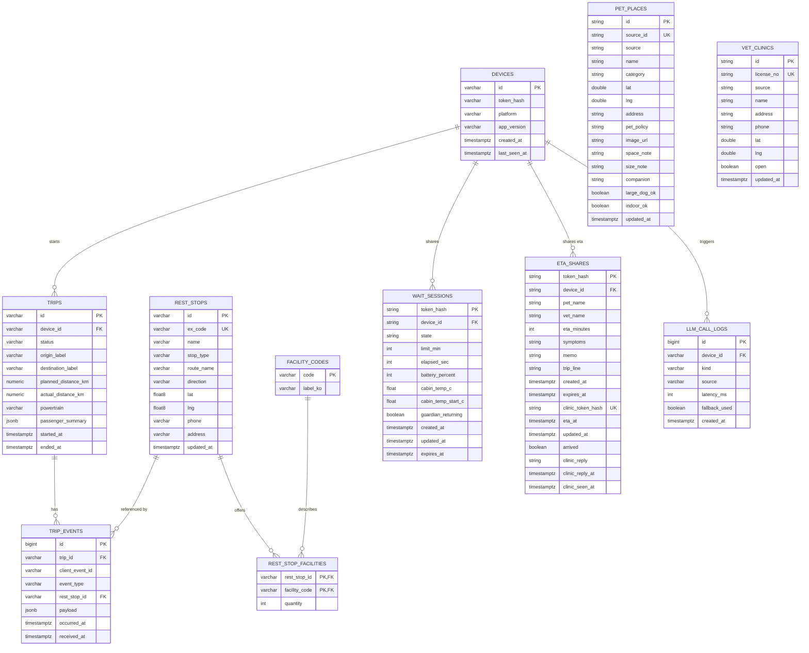
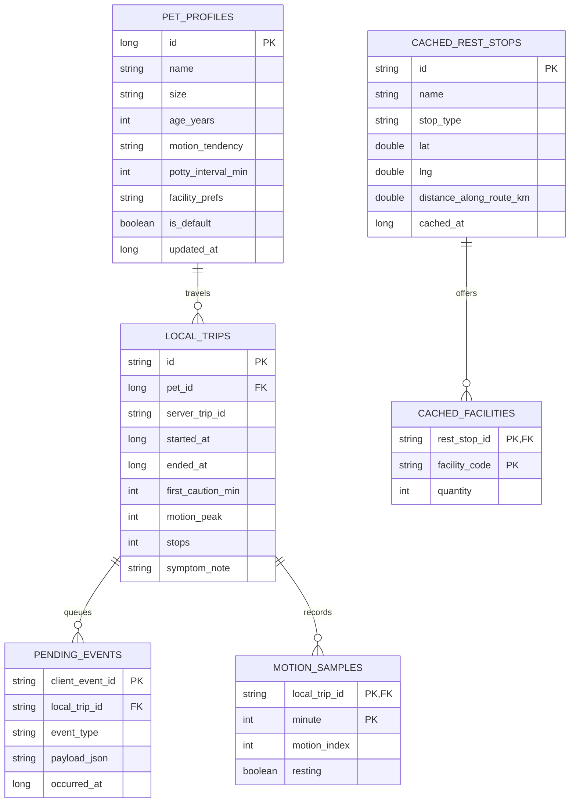

# DB 스키마 — 같이가개 (반려견과 차로 가는 모든 순간)

데이터는 두 곳에 나뉜다. **서버 PostgreSQL**은 공용 데이터(휴게소·반려동물 동반 장소·동물병원), 익명 여행 이벤트, 대기 공유 상태를, **기기 Room DB**는 개인 데이터(반려견 프로필·이동 기록)와 오프라인 캐시를 맡는다. 개인 데이터는 서버로 보내지 않는다.

**테스트 정책.** 서버 DB 테스트는 두 층으로 나눈다. 마이그레이션 검증과 통합 테스트는 PostgreSQL 16에서 돌린다(로컬은 `docker compose`, CI는 GitHub Actions service container). 아래 DDL의 `JSONB`·`BIGSERIAL`·`TIMESTAMPTZ`·`'{}'::jsonb`는 PostgreSQL 전용이므로, Alembic 마이그레이션은 PostgreSQL에서만 검증한다. 단위 테스트는 SQLite in-memory에서 돌리며, SQLAlchemy 모델은 `JSON().with_variant(JSONB(), "postgresql")`, `BigInteger().with_variant(Integer, "sqlite")`처럼 방언별 타입을 쓴다. PostgreSQL 전용 테스트는 `@pytest.mark.pg` 마커로 구분하고, DB에 연결할 수 없으면 skip한다.

## 1. 서버 ERD (PostgreSQL 16)



`PET_PLACES`·`VET_CLINICS`는 다른 테이블과 관계가 없는 공용 데이터 테이블이다. 쉼표 때의 `content_episodes`·`missions`·`playlists`·`playlist_items`는 마이그레이션 0002에서 삭제했다.

### 테이블 설명

| 테이블 | 용도 | 비고 |
| --- | --- | --- |
| `devices` | 익명 기기 | 토큰 원문은 저장하지 않음 |
| `rest_stops` | 휴게소·졸음쉼터 | `stop_type`: `service_area` · `drowsy_shelter`, 도로공사 코드 `ex_code` 고유 |
| `facility_codes` | 편의시설 코드표 | `pet_zone`(반려견 놀이터), `ev_fast`, `ev_slow`, `nursing_room`, `kids_zone`, `shower`, `accessible_toilet`, `sleep_room` |
| `rest_stop_facilities` | 휴게소별 편의시설 | 충전기는 `quantity`에 대수 |
| `pet_places` | 반려동물 동반 장소 (F4) | `source`: `tourapi` · `sample`. `category`: `restaurant` · `cafe` · `lodging` · `tour` · `walk`. 0004: `image_url`·`space_note`·`size_note`·`companion` — 동반 조건 원문(판정·추측 없음, 모르면 NULL). 실제 데이터가 들어오면 샘플 행은 지운다 |
| `vet_clinics` | 동물병원 (F5) | `source`: `licensing` · `sample`. 영업 중(`open`)만 서비스. 샘플은 전화번호 없음 |
| `wait_sessions` | 대기 공유 (F3) | 토큰 원문 대신 SHA-256 해시를 키로. **위치 컬럼 없음**. 2시간 만료. `guardian_returning`(0004): 폰 "돌아가는 중" |
| `eta_shares` | 동물병원 도착 예정 공유 (F5, 0004) + 사전 접수 (UPGRADE 3, 0005) | 해시 키, **위치 컬럼 없음**, 이름·병원·도착 예정 분·증상 메모만, 2시간 만료. 0005: 병원 접수함 토큰 해시(고유), 갱신된 도착 예정 시각(`eta_at`)·`arrived`, 병원 응답(`clinic_reply` ∈ received·ready·busy)·응답 시각·열람 시각 |
| `trips` | 여행 단위 | 동승자는 인원 수만(`{"adults","children","pets"}` 정수). 반려견 이름·체급·나이는 받지 않는다 |
| `trip_events` | 여행 중 이벤트 | `(trip_id, client_event_id)` 고유로 중복 방지 |
| `llm_call_logs` | LLM 품질 모니터링 | 프롬프트·응답 원문 저장 안 함 |

## 2. DDL 초안 (PostgreSQL)

```sql
-- 기기
CREATE TABLE devices (
    id            VARCHAR(32) PRIMARY KEY,
    token_hash    VARCHAR(128) NOT NULL,
    platform      VARCHAR(32)  NOT NULL,
    app_version   VARCHAR(16)  NOT NULL,
    created_at    TIMESTAMPTZ  NOT NULL DEFAULT now(),
    last_seen_at  TIMESTAMPTZ  NOT NULL DEFAULT now()
);

-- 휴게소
CREATE TABLE rest_stops (
    id          VARCHAR(32)  PRIMARY KEY,
    ex_code     VARCHAR(32)  NOT NULL UNIQUE,
    name        VARCHAR(64)  NOT NULL,
    stop_type   VARCHAR(16)  NOT NULL CHECK (stop_type IN ('service_area', 'drowsy_shelter')),
    route_name  VARCHAR(64)  NOT NULL,
    direction   VARCHAR(32)  NOT NULL,
    lat         DOUBLE PRECISION NOT NULL,
    lng         DOUBLE PRECISION NOT NULL,
    phone       VARCHAR(32),
    address     VARCHAR(255),
    updated_at  TIMESTAMPTZ  NOT NULL DEFAULT now()
);
CREATE INDEX idx_rest_stops_route ON rest_stops (route_name, direction);
CREATE INDEX idx_rest_stops_latlng ON rest_stops (lat, lng);

CREATE TABLE facility_codes (
    code      VARCHAR(32) PRIMARY KEY,
    label_ko  VARCHAR(64) NOT NULL
);

CREATE TABLE rest_stop_facilities (
    rest_stop_id   VARCHAR(32) NOT NULL REFERENCES rest_stops(id) ON DELETE CASCADE,
    facility_code  VARCHAR(32) NOT NULL REFERENCES facility_codes(code),
    quantity       INTEGER     NOT NULL DEFAULT 1 CHECK (quantity >= 0),
    PRIMARY KEY (rest_stop_id, facility_code)
);

-- 반려동물 동반 장소 (F4, 마이그레이션 0003)
CREATE TABLE pet_places (
    id          VARCHAR(32)  PRIMARY KEY,
    source_id   VARCHAR(64)  NOT NULL UNIQUE,
    source      VARCHAR(16)  NOT NULL CHECK (source IN ('tourapi', 'sample')),
    name        VARCHAR(128) NOT NULL,
    category    VARCHAR(16)  NOT NULL CHECK (category IN ('restaurant', 'cafe', 'lodging', 'tour', 'walk')),
    lat         DOUBLE PRECISION NOT NULL,
    lng         DOUBLE PRECISION NOT NULL,
    address     VARCHAR(256),
    pet_policy  TEXT,
    updated_at  TIMESTAMPTZ  NOT NULL DEFAULT now()
);
CREATE INDEX idx_pet_places_latlng ON pet_places (lat, lng);

-- 동물병원 (F5, 마이그레이션 0003)
CREATE TABLE vet_clinics (
    id          VARCHAR(32)  PRIMARY KEY,
    license_no  VARCHAR(64)  NOT NULL UNIQUE,
    source      VARCHAR(16)  NOT NULL CHECK (source IN ('licensing', 'sample')),
    name        VARCHAR(128) NOT NULL,
    address     VARCHAR(256),
    phone       VARCHAR(32),
    lat         DOUBLE PRECISION NOT NULL,
    lng         DOUBLE PRECISION NOT NULL,
    open        BOOLEAN      NOT NULL DEFAULT true,
    updated_at  TIMESTAMPTZ  NOT NULL DEFAULT now()
);
CREATE INDEX idx_vet_clinics_latlng ON vet_clinics (lat, lng);

-- 대기 공유 (F3, 마이그레이션 0003). 위치 컬럼을 두지 않는다.
CREATE TABLE wait_sessions (
    token_hash       VARCHAR(64) PRIMARY KEY,
    device_id        VARCHAR(32) NOT NULL REFERENCES devices(id) ON DELETE CASCADE,
    state            VARCHAR(16) NOT NULL DEFAULT 'waiting' CHECK (state IN ('waiting', 'overdue', 'ended')),
    limit_min        INT         NOT NULL CHECK (limit_min BETWEEN 1 AND 120),
    elapsed_sec      INT         NOT NULL DEFAULT 0,
    battery_percent  INT,
    cabin_temp_c     DOUBLE PRECISION,
    created_at       TIMESTAMPTZ NOT NULL DEFAULT now(),
    updated_at       TIMESTAMPTZ NOT NULL DEFAULT now(),
    expires_at       TIMESTAMPTZ NOT NULL
);
CREATE INDEX idx_wait_sessions_device ON wait_sessions (device_id);

-- 여행
CREATE TABLE trips (
    id                   VARCHAR(32) PRIMARY KEY,
    device_id            VARCHAR(32) NOT NULL REFERENCES devices(id) ON DELETE CASCADE,
    status               VARCHAR(16) NOT NULL DEFAULT 'active' CHECK (status IN ('active', 'ended')),
    origin_label         VARCHAR(64),
    destination_label    VARCHAR(64),
    planned_distance_km  NUMERIC(7,1),
    actual_distance_km   NUMERIC(7,1),
    powertrain           VARCHAR(8) CHECK (powertrain IN ('ev', 'ice', 'hev')),
    passenger_summary    JSONB       NOT NULL DEFAULT '{}'::jsonb,
    started_at           TIMESTAMPTZ NOT NULL,
    ended_at             TIMESTAMPTZ
);
CREATE INDEX idx_trips_device ON trips (device_id, started_at DESC);

CREATE TABLE trip_events (
    id               BIGSERIAL   PRIMARY KEY,
    trip_id          VARCHAR(32) NOT NULL REFERENCES trips(id) ON DELETE CASCADE,
    client_event_id  VARCHAR(64) NOT NULL,
    event_type       VARCHAR(32) NOT NULL CHECK (event_type IN (
                        'recommendation_shown', 'recommendation_accepted', 'recommendation_declined',
                        'stop_started', 'stop_ended', 'fatigue_peak', 'motion_peak',
                        'pause_activity_started', 'pause_activity_ended', 'wait_started', 'wait_ended')),
    rest_stop_id     VARCHAR(32) REFERENCES rest_stops(id),
    payload          JSONB       NOT NULL DEFAULT '{}'::jsonb,
    occurred_at      TIMESTAMPTZ NOT NULL,
    received_at      TIMESTAMPTZ NOT NULL DEFAULT now(),
    UNIQUE (trip_id, client_event_id)
);
CREATE INDEX idx_trip_events_trip ON trip_events (trip_id, occurred_at);

CREATE TABLE llm_call_logs (
    id             BIGSERIAL   PRIMARY KEY,
    device_id      VARCHAR(32) REFERENCES devices(id) ON DELETE SET NULL,
    kind           VARCHAR(32) NOT NULL,
    source         VARCHAR(16) NOT NULL CHECK (source IN ('ollama', 'template')),
    latency_ms     INTEGER     NOT NULL,
    fallback_used  BOOLEAN     NOT NULL DEFAULT FALSE,
    created_at     TIMESTAMPTZ NOT NULL DEFAULT now()
);

-- 초기 코드표
INSERT INTO facility_codes (code, label_ko) VALUES
    ('nursing_room', '수유실'),
    ('kids_zone', '키즈존'),
    ('pet_zone', '반려동물 놀이터'),
    ('ev_fast', '전기차 급속충전기'),
    ('ev_slow', '전기차 완속충전기'),
    ('shower', '샤워실'),
    ('accessible_toilet', '장애인 화장실'),
    ('sleep_room', '수면실');
```

### 보관 정책
| 데이터 | 보관 기간 |
| --- | --- |
| `trips`, `trip_events` | 90일 후 삭제 (일 1회 정리 잡) |
| `llm_call_logs` | 30일 |
| `devices` | 마지막 접속 후 180일 |
| `wait_sessions` | 만료(2시간) 후 1일 |
| `eta_shares` | 만료(2시간) 후 1일 |
| `pet_places`, `vet_clinics` | 수집 잡이 덮어씀(공용 데이터) |

## 3. 기기 Room DB



| 테이블 | 메모 |
| --- | --- |
| `pet_profiles` | `size`: `SMALL` · `MEDIUM` · `LARGE`, `motion_tendency`: `LOW` · `NORMAL` · `HIGH`, `facility_prefs`: 쉼표로 구분한 시설 코드(`pet_zone` 등). **서버 전송 안 함** |
| `local_trips` | 이동 기록(F7). `first_caution_min` = 멀미 지수가 주의(40)에 처음 닿은 주행 분 → 여러 여행의 중앙값으로 "한계 시간" 추정. `symptom_note`는 기기에만 |
| `motion_samples` | 5분 간격 멀미 지수 (기록 그래프) |
| `pending_events` | 오프라인 이벤트 큐. 업로드 성공 시 삭제 |
| `cached_rest_stops`, `cached_facilities` | 출발 시 경로 기준으로 교체. 앱에 기본 데이터 번들 포함 |

1초 차량 신호는 DB에 저장하지 않고 메모리에만 둔다. 장소·병원 캐시는 마지막 응답 JSON을 그대로 보관한다(오프라인 표시용).
