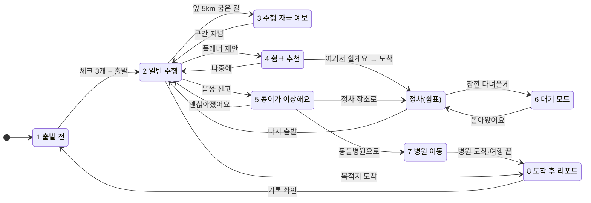

# 같이가개 8개 상태와 전환 (2026-10-31 재정비)

같이가개는 지도를 그리지 않는다. 길 안내는 **Pleos 기본 내비**가 맡고, 같이가개는 주행 중 **분할 창**(기본 내비 옆 1/3·1/2)에서
NaviHelper 실제 값(다음 회전·남은 거리·도착)과 반려견 정보를 보여 준다. 정차 화면(출발 전·쉼표·대기·리포트)은 전체 창이 기준이다.

원칙 (사용자 결정 10/31, `_private/RESTRUCTURE_PROMPT.md`):
- 엔진 0~100 값은 **주행 자극**(차량 흔들림 누적, ISO 2631-1 단순화)이다. 반려견 몸을 잰 값이 아니다. 단계: 낮음 < 40 ≤ 보통 < 70 ≤ 높음.
- 반려견 상태는 **콩이 관찰 상태** = 보호자 음성 신고만. 신고가 없으면 "관찰 기록 없음". 두 값을 섞지 않고, 진단·확률 표현을 쓰지 않는다.
- 주행 자극 숫자·그래프는 ① 정차 중 "주행 자극 보기" ② 도착 후 리포트 ③ 발표 모드 비교에서만 보인다. 주행 중에는 예보 한 줄.
- 시뮬레이터 값은 앱 바에 "시연 데이터". 실제 신호가 없는 항목은 숨긴다.

## 상태 표

| # | 상태 | 화면 (`Route` · `DriveContent`) | 들어오는 조건 | 핵심 내용 | 주행 중 제한 |
| --- | --- | --- | --- | --- | --- |
| 1 | 출발 전 | `DEPART` (첫 실행이면 `ONBOARDING`) | AppMode PREPARE | 하네스·물·배변봉투 체크(저장), 목적지·예상 시간(NaviHelper), 예상 쉼표 | 정차 중만 |
| 2 | 일반 주행 | `DRIVE` · `Calm`/`Heading` | DriveState DRIVING/RESTRICTED | 다음 회전·남은 거리·도착(NaviHelper) / 다음 쉼표(시간·장소·확인된 반려견 시설) / 콩이 관찰 상태 한 줄 / 음성 힌트 | 2줄·버튼 0 |
| 3 | 주행 자극 예보 | `DRIVE` · `Forecast` | 앞 5km 안 굽은 길 예보 | "3km 뒤 굽은 길 · 12분" + "천천히 가면 덜 흔들려요" 한 줄 + 음성 | 1줄 경고만, 숫자 없음 |
| 4 | 쉼표 추천 | `DRIVE` · `Suggest` | 플래너 제안 | 장소·도착까지·거리·이유 2개(확인된 시설만) | 버튼 2개 + 음성 |
| 5 | 콩이가 이상해요 | `DRIVE` · `Distress` (정차 중은 `REST` 고르기) | 음성 신고("콩이 토했어") | 신고·시각·당시 속도·주행 자극 저장 → 1줄 안내 → 심하면 병원 제안 | 음성 중심, 버튼 2개 |
| 6 | 대기 모드 | `WAIT` | "잠깐 다녀올게" + P단 | 경과 시간, 보호자 폰 페이지, 온도는 측정값이 있을 때만, "혼자 오래 두지 마세요" | P단만 |
| 7 | 병원 이동 | `DRIVE` · `Vet` / `VETS` (병원으로 가는 중) | 상태 5에서 "동물병원으로" 또는 정차 중 병원 선택 | 병원 선택 → 경유지(NaviHelper) → 보낼 내용 확인·전달 동의 → 도착 예정 자동 갱신 → 병원 응답 1줄. 제휴 병원만 접수, 그 밖은 전화·링크 | 입력은 정차·음성 |
| 8 | 도착 후 기록 리포트 | `ARRIVAL` → `TRIPLOG` | AppMode ARRIVED (+ "내렸어요") | 요약(총 이동 시간·거리·휴식·관찰 신고) → 시간순 타임라인 → 주행 자극 그래프(차량 기준 표기) → 병원 공유·지난 기록 | 정차 중만 |
| – | 정차 | `REST` · `STIMULUS` · `PLACES` · `PET` · `SETTINGS` | 휴게소 정차·위로 연 화면 | 쉼표 활동, "주행 자극 보기", 함께 가는 장소, 프로필, 설정 | 정차 중만 |

화면 선택은 `presentation/ScreenRouter.route`(우선순위: 장면 고정 → 주행 → 대기 → 설정·프로필 → 온보딩 → 장소·병원·주행 자극 보기 → AppMode),
서비스 상태 번호는 `ScreenRouter.serviceState`(테스트 `RestructureTest` ST-01)가 정한다.

## 전환

## 데이터 출처 (상태별, 지어내지 않는다)

| 값 | 출처 | 없으면 |
| --- | --- | --- |
| 다음 회전·방면 | NaviHelper `onTBTInfo` 첫 항목 (`Snapshot.guide`) | 카드에 "다음 회전 안내를 기다리는 중". 시뮬레이터는 GPX에서 만든 안내에 "시연" 표시 |
| 남은 거리·시간·도착 | NaviHelper `onDestinationInfo` remainDistance·remainTime + 지금 시각 | 줄을 숨긴다 |
| 다음 쉼표·시설 | 휴게소 데이터(서버·캐시·내장) + 플래너 | "남은 길에 잡힌 쉼표가 없어요" |
| 콩이 관찰 상태 | 보호자 음성 신고(`TripUi.distressEvents`) | "관찰 기록 없음" |
| 주행 자극 | 엔진(MotionComfortEngine) | 정차 중 "아직 달린 기록이 없어요" |
| 실내 온도 | Vehicle `getHvacTemperatureCurrent` 측정값 | 표시하지 않음 |
| 리포트 경로선 | 위치를 남기지 않음 (사용자 결정 10/31 안 A) | 거리만 |
