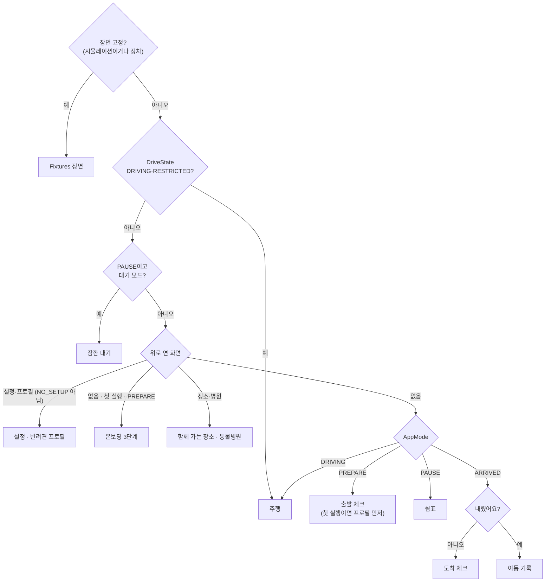

# 화면 계약 — 같이가개 (UiState · UiEvent · 주행 중 제한)

화면은 **디자인 v6**(docs/design/v6/STYLE_V6.md, v5는 대체됨)로 그린다: `app/.../ui/screens/DriveScreens.kt`(주행)·`PetScreens.kt`(정차 화면)·`ScreenFrame.kt`(공통 틀), `ui/components/Kit.kt`(부품)·`Illustrations.kt`(직접 그린 일러스트), `ui/theme/`(토큰). v5에서 계약에 더한 값은 모두 기본값이 있어 이전 화면·테스트를 깨지 않는다(아래 "v5에서 더한 값").

- 상태: `core/uistate/.../ScreenStates.kt`, 바깥 틀 `UiContract.kt`(`AppUiState`·`Screen`·`UiEvent`·`Scene`)
- 엔진 → 상태: `app/.../presentation/UiMapper.kt` (순수 함수, `EmptyStatesTest`·`DrivingUiScenarioTest`)
- 화면 선택: `app/.../presentation/ScreenRouter.kt` (순수 함수, `ScreenRouterTest`)
- 미리보기·발표 모드 장면 고정: `Fixtures.screen(Scene)`
- 에뮬레이터 캡처(2026-10-30, v5): `artifacts/ui/final_v5/` (로컬, gitignore), 비교 기록은 [ui_review.md](ui_review.md) "v5"

## 화면 선택

## 화면별 계약

| 화면 (`Screen`) | 상태 필드 | 이벤트 (`UiEvent`) | 언제 | 주행 중 |
| --- | --- | --- | --- | --- |
| 출발 체크 `Depart` | `meta`, `pet`(이름·한 줄·샘플), `checks`(하네스/켄넬·물·배변봉투), `ready`, `plan`(오늘의 쉼표), `rationale`, `limitLine` | `ToggleCheck`, `StartTrip`(ready일 때만), `OpenPet`, `OpenSettings` | PREPARE | 열리지 않음 |
| 주행 `Drive` | `meta`, `motion`(지수·단계·한 줄), `content` = `Calm` 안내 · `Forecast` 멀미 예보 · `Suggest` 쉼표 추천 · `Heading` 가는 중, `voice`, `toast`, `restricted`, `offline` | `AcceptSuggestion`, `DeclineSuggestion` | DRIVING 또는 DriveState 제한 | 아래 "주행 중 제한" |
| 쉼표 추천 (`Drive.Suggest`) | `minutes`, `place`, `reasons`(기여 상위 1~2개), `urgent`(운전자 피로 위험 → 버튼 1개) | 위와 같음 + 음성 "여기서 쉴게요"/"나중에" | 플래너가 제안할 때 | 버튼 2개 + 음성 힌트 |
| 쉼표 `Rest` | `meta`, `lead`, `minutes`, `restChoice`(10/15/20), `activities`(산책·물/배변·스트레칭, 추천 1개), `motion`, `waitLimitMin`, `battery` | `SetRestMinutes`, `StartActivity`, `StartWait`, `OpenPlaces`, `OpenVets` | PAUSE | 주행 화면으로 바뀜 |
| 잠깐 대기 `Wait` (바깥 사람용) | `headline`("주인이 곧 돌아와요"), `elapsed`, `cabin`(없으면 "실내 온도 정보 없음"), `battery`, `limitMin`, `overdue`, `share`(폰 주소·연결) | `StopWait`, `SetWaitLimit` | PAUSE + "잠깐 다녀올게" | 즉시 끝남 (F3-04) |
| 함께 가는 장소 `Places` | `items`(이름·분류·거리·정책·샘플), `note`(출처), `loading` | `GoPlace`(경유지), `Close` | 정차 중 쉼표 화면에서 | 열리지 않음 |
| 동물병원 `Vets` | `items`(이름·거리·주소·전화(실데이터만)·샘플), `note`, `loading` | `GoVet`(경유지로 안내), `Close` | 정차 중 | 열리지 않음 |
| 도착 체크 `Arrival` | `question`("콩이 내렸나요?"), `strong`(26℃↑·여름), `detail` | `ConfirmLeft` | ARRIVED, 확인 전 | — |
| 이동 기록 `TripLog` | `summary`(LLM·템플릿), `durationMin`, `stops`, `motionPeak`, `motionSeries`, `limitLine`, `vetSummary`, `symptoms` | `ToggleSymptom`, `FinishTrip` | ARRIVED, 확인 후 | — |
| 반려견 프로필 `PetProfile` | `name`, `size`, `ageYears`, `tendency`, `pottyIntervalMin`, `petZonePreferred`, `problems`, `firstRun` | `SetPetName`, `SetPetSize`, `SetPetAge`, `SetPetTendency`, `SetPotty`, `TogglePetZone`, `SavePet`, `Close` | 첫 실행 또는 "바꾸기" | 열리지 않음 (키보드) |
| 온보딩 `Onboarding` (v5 11번) | `step`(1 프로필 · 2 차량 연동 · 3 멀미 민감도), `pet`, `signals`, `quiz`(질문 3개·고른 답), `result`(3단계), `canNext` | `OnboardNext`, `OnboardBack`, `AnswerQuiz`, 프로필 이벤트, `Close`(나중에) | 첫 실행 PREPARE | 열리지 않음 |
| 설정 `Settings` | `timing`, `voiceSuggest`, `reduceMotion`, `signals`(쓰는 신호와 출처), `version`, `credits`(데이터 출처 — OSM ODbL 표기, 빼지 않는다) | `SetTiming`, `ToggleVoice`, `ToggleReduceMotion`, `DeleteData`, `Close` | "설정" | 열리지 않음 |

공통: `LogoTap`(3초 안 5번 → 발표 모드 패널, 실차 주행 중에는 숨김).

## v6·사전 접수에서 더한 값 (2026-10-30 낮) — 모두 기본값이 있어 이전 화면·테스트를 깨지 않는다
| 상태 | 값 | 뜻 |
| --- | --- | --- |
| `DriveContent.Forecast` | `startMin`·`durationMin`·`startM` | 엔진 예보의 굽은 길 시작까지 분·지속 분·시작까지 m → 20분 예보 그래프·경로 보기 앰버 구간 |
| `DriveUi` | `nextStopName`·`nextStopMin` | 상태 패널 "다음 쉼표까지 1시간 32분 · 횡성휴게소 · 138km" |
| `DriveContent.Vet` | `clinic` | 병원 사전 접수 상태 한 줄(24자, DrivingRules 검사) |
| `VetsUi` | `intake: IntakeUi?` | 병원 접수함 링크·도착 예정 분·상태 한 줄·병원 응답 여부(`busy`면 다른 병원) |
| `TripLogUi` | `calibration` | 답한 뒤 "콩이 맞춤 정도: 기록 4회, 민감도 보통 → 높음" |

이벤트는 늘리지 않았다: `ShareVetEta(id)`가 이제 사전 접수(보호자 링크 + 병원 접수함 링크)를 만든다.

## v5에서 더한 값 (2026-10-30)
| 상태 | 값 | 비고 |
| --- | --- | --- |
| `DriveUi` | `pet`, `sinceRest`("마지막 휴식 후 52분"), `nextStop`("약 72km"), `roadAhead`(앞 1km 곡률, 도로 일러스트) | 2번 상태 패널·도로 그림 |
| `DriveContent.Forecast` | `title`(1줄), `coach`(1줄), `now`, `peak` | 3번. 각 24자 이하 (`DrivingRules.MAX_LINE_CHARS`) |
| `DriveContent.Suggest` | `distance`("8km"), `direction`("강릉 방향") | 4번. 버튼 "여기서 쉴게요"/"다음 휴게소로" |
| `DriveContent.Vet` (새) | `name`(14자), `distance`, `minutes` | 8번 주행 중: 1순위 병원 2줄만 |
| `DepartUi` | `route`("강릉까지"), `duration` | 1번 경로 카드 |
| `WaitUi` | `batteryUsed`(신호 있을 때만), `notice`(켤 때 20초 안전 안내) | 5번. 보호자 "돌아가는 중"이면 `headline`이 바뀐다 |
| `PlaceUi` / `PlacesUi` | `imageUrl`, `tags`(동반 구분 "전구역/일부구역 동반"만), `notes`(동반 조건 원문 문장 — 실내·대형견을 판정하지 않음, 결정 10/30) / `credit`("사진 한국관광공사") | 7번 |
| `VetUi` / `VetsUi` | `minutes`, `status`("영업 중", 실데이터만) / `memo`(증상 고르기), `shareUrl` | 8번. 영업시간·24시는 쓰지 않는다. 이벤트 `ShareVetEta` |
| `ArrivalUi` | `warning`("여름철 실내 온도 주의!"), `cabin`(신호 있을 때만) | 9번 |
| `TripLogUi` | `warnings`(멀미 주의 횟수), `history` | 10번 |
| `Scene` | `VET_DRIVE`, `ARRIVAL_HOT`, `ONBOARD_1..3` | 발표 모드 장면 고정 |

화면 안에서만 쓰는 값(상태 계약 밖): 장소 분류 칩 선택(`rememberSaveable`), 창 폭 단계(`WidthClass`), 사진 자리(assets → 일러스트).

## 주행 중 제한 (CONCEPT 5장, test_plan DS-01~DS-04)
- 텍스트 덩어리 48자(2줄) 이하, 장소 이름 14자 이하, 이유 2개 이하 — `DrivingRules.violations`가 0이어야 한다(시나리오 전 구간 테스트).
- 버튼은 쉼표 추천 2개(피로 위험 1개), 음성 실패 시트 2개, 그 밖에는 0개. 음성 힌트 한 줄.
- 스크롤·키보드·자동 애니메이션 없음. 주행 화면은 스크롤 없는 `Page(scroll = false)`.
- RESTRICTED: 멀미 줄·이유 알약을 숨기고 가장 급한 한 줄만.
- LIMIT_STRING_LENGTH: 첫 문장만, 이유는 1개 (`UxPolicy.apply`).
- 멀미 예보 문구는 이름이 길어 48자를 넘으면 이름을 빼고 말한다 (`MotionPhrases`).

## 빈·로딩·오류 상태
| 상황 | 화면 |
| --- | --- |
| 경로·엔진 값 없음 | 주행: 메타·멀미 줄 없이 안내 한 줄 |
| 서버 없음 | 휴게소·장소·병원은 앱 내장 샘플("샘플" 알약), 주행 화면 아래 "인터넷 없이 내장 데이터로 안내 중" |
| 실내 온도 신호 없음 | 대기: "실내 온도 정보 없음" (지어내지 않음) |
| 폰 공유 실패 | 대기: "폰 공유 연결 안 됨 — 차 화면 안내는 계속돼요" |
| 장소·병원 찾는 중 / 없음 | "찾는 중…" / "근처에 찾은 곳이 없어요." |
| 프로필 미저장 | 출발 체크 `pet.sample = true`, 첫 실행이면 프로필 화면 |

## 2026-10-31 추가 (기본값 있음, 기존 화면·테스트 그대로)
- `DriveContent.Forecast.series: List<Int>` — 엔진 예측 곡선(1분 간격, 0번 = 지금, 최대 21개). 그래프는 이 점만 잇는다. `peak` = 이 곡선의 최고.
- `DriveUi.nextCurve: String?`("3.4km", 구간 안이면 "지금") · `DriveUi.recentMotion: List<Int>`(최근 30분, 1분 간격).
- `TripLogUi.limitLine`은 이제 이번 여행 값을 먼저 보는 한 줄(`PetTripLog.insight`), `warnings`는 1초 값 기준 주의 횟수.

## 2026-10-31 재정비 (v8, docs/states.md) — 계약을 바꿨다 (기본값 있음, 저장 데이터·서버 API는 그대로)
원칙: 엔진 0~100 = **주행 자극**(차량 흔들림), 반려견 상태 = **관찰 상태**(음성 신고만). 주행 화면에 주행 자극 숫자가 없다. 문구는 [wording.md](wording.md).

| 상태 | 바뀐 값 |
| --- | --- |
| `DriveUi` | 지움: `motion`, `roadAhead`, `nextCurve`, `recentMotion`. 새로: `guide: GuideUi?`(NaviHelper TBT 첫 항목 — 아이콘·거리·방면, 시뮬레이터 시연 안내는 `demo`), `remain`("194km · 2시간 33분"), `arrive`("오후 7:44"), `observation: ObservationUi`("관찰 기록 없음" / "신고 n건 · 마지막"), `nextStopFacilities`(확인된 반려견 시설만), `voiceHint` |
| `DriveContent.Forecast` | `title`("3km 뒤 굽은 길 · 8분") + `coach`("천천히 가면 덜 흔들려요") + `level` + `basis`(근거 한 줄). 지움: `now`·`peak`·`series`·`startMin`·`durationMin`·`startM`. `line` = 제목 · 안내 |
| `StimulusUi` (새 화면 `Screen.Stimulus`, `Route.STIMULUS`, `UiEvent.OpenStimulus`) | 정차 중 "주행 자극 보기": 지금·이번 여행 최고·최근 30분·앞길 예보·근거, 고정 문구 "차량 흔들림 기준 · 반려견 측정 아님" |
| `RestUi` | 지움: `motion`. 새로: `observation`, `stimulusAvailable` |
| `TripLogUi` (도착 후 리포트) | 다시 씀: `totalMin`·`distance`·`stops`·`reports`, `timeline: List<TimelineUi>`(START·STIMULUS·REPORT·REST·VET·ARRIVE, 출발 뒤 시각), `stimulusSeries`, `marks`(STOP·SYMPTOM·HIGH), `insight`, `summary`, `share: List<VetRowUi>`, `history`, `calibration`. 지움: v7 `status`·`symptoms`·`askMotion`·`arrivalIndex` 등 |
| `VetUi.partner`, `VetsUi.preview` | 사전 접수는 제휴(시연용 가상) 병원만, 보내기 전 미리보기 |
| `AppUiState.state: ServiceState`(8개), `demoData` | 발표 모드 상태 번호, 앱 바 "시연 데이터" |
| `UiEvent` | 지움: `ToggleSymptom`, `AnswerMotion`(+ `MotionAnswerUi`). 새로: `OpenStimulus`, `ShareReport` |
| `MotionTone` 글자 | 낮음 / 보통 / 높음 (40·70) |

## 2026-11-04 v10-1 주행 경험 (`_private/V10_1_DRIVE.md`) — 기본값 있음
| 상태·이벤트 | 값 | 뜻 |
| --- | --- | --- |
| `DriveUi` | `barLine`("27km · 도착 오전 11:45"), `talk`, `micDenied`, `quiet` | 앱 바 작은 한 줄(회전·도착 카드 삭제), [눌러서 말하기] 보일지(버튼 2개 카드면 기본값 false — 실제 표시는 `DrivingRules.talkShown`), 마이크 거절 힌트, 조용히 모드 |
| `DepartUi` | `dayOff` | "오늘은 안 타요" 띠 + [다시 켜기] |
| `SettingsUi` | `guidance`(0 많이·1 보통·2 적게), `quiet` | 안내 빈도·조용히 모드 |
| `RestUi` | `notices` | 정차 때 한 줄씩(자동 시작 뒤 출발 체크, 앱이 뒤에 있을 때 답이 없던 추천) |
| `UiEvent` | `PushToTalk`, `DayOff`, `DayOn`, `SetGuidance(level)`, `ToggleQuiet` | 말하기는 받아쓰기 8초 → 기존 분류(+ "조용히 해 줘"·"오늘은 안 타요") |

주행 중 버튼 수: 버튼 2개 카드(쉼표 추천·주변 추천·이상해요)는 2개, 그 밖에는 [눌러서 말하기] 1개(듣는 중·RESTRICTED·마이크 거절이면 0) — `DrivingRules.buttons`.

## 2026-11-04 v10-2 UI 기준 (`docs/design/v10/STYLE_V10.md`) — 배치·글자·구분만, 기본값 있음
| 상태 | 값 | 뜻 |
| --- | --- | --- |
| `StimulusUi` | `ahead`(엔진 예측 1분 21점), `curveStartMin`·`curveLenMin`(굽은 길 시작·길이 분), `curveKm`("3.4km 앞"), `clockMinute`(신호 시계) | "주행 자극 보기" 그래프·수치 3개(현재 · 예측 최고(시각) · 위험 구간). 정차 중에는 예보가 없어 `ahead`가 비고 지나온 값만 그린다 |
| `CompareChart` | `peak(points)`·`mean(points)`(거리 가중 평균) | 고갯길 비교 수치(최고값·평균 차이) |

## 2026-11-04 v10-3 편의 기능 (`_private/V10_3_FEATURES.md`) — 기본값 있음
| 상태·이벤트 | 값 | 뜻 |
| --- | --- | --- |
| `DepartUi` | `riders: List<RiderUi>`(프로필 2개 이상일 때만), `sameAsLast`, `CheckUi.missedBefore` | 오늘 타는 아이 칩, [지난번과 같아요], "지난번에 빠뜨렸어요" |
| `PetEditUi` | `profiles`(탭), `canAdd`, `canDelete`, `photoAvailable`, `photoUrl`, `photoNote` | 여러 마리(최대 3)·사진 QR 업로드 |
| `RestUi` | `whoAsk` | 여러 마리 신고 이름 고르기 |
| `WaitUi` | `returningBy` | "보호자 2가 돌아가는 중이에요" |
| `ShareUi.second(url)` | `url?g=2` | 두 번째 보호자 QR |
| `SummaryUi` | `phoneUrl`, `phoneBusy`, `phoneAvailable`, 상수 `FINISH`·`PHONE`·`OPEN_REPORT`("자세히 보기") | 도착 요약에서 끝 |
| `AppUiState` | `demoPhoto`, `primaryPetId` | 사진 자리: 올린 사진 → 시연이면 콩이 사진 → 실루엣 |
| `UiEvent` | `SendReportToPhone`, `CloseReport`, `SameAsLast`, `ToggleRider(id)`, `EditPet(id)`, `AddPet`, `DeletePet`, `PickWho(name)`, `StartPhotoUpload` | |

## 콩이 도우미 (2026-11-04, `_private/HELPER_PROMPT.md`)
| 상태·이벤트 | 값 | 뜻 |
| --- | --- | --- |
| `Screen.Helper(HelperUi)` | `Route.HELPER` · `Overlay.HELPER` (긴급 도움 다음, 대기보다 먼저 — 주행이면 주행 화면) | 정차 중 겹침 화면 `ui/screens/HelperScreen.kt` |
| `HelperUi` | `chips`(상황별 6개), `answers: List<HelperAnswerUi>`(최근이 앞, 최대 5), `text`, `listening`, `busy`, `typing`(정차 + `UxPolicy.setupAllowed`) | 상수 `TITLE`·`NOTE`·`UNKNOWN`·`UNKNOWN_VET`·`UNKNOWN_REST`·`DRAFT` |
| `HelperAnswerUi` | `question`, `title`, `lines`(≤4), `action`(VET·NEAREST_STOP·POTTY_SPOT·WAIT_MODE·NEXT_REST), `actionLabel`, `source`, `reviewed`, `explained`, `emergency` | 답 카드 한 장 |
| `UiEvent` | `OpenHelper`, `AskHelper(text)`, `SetHelperText(text)`, `HelperVoice`, `HelperAct(index)` | 행동은 기존 흐름 재사용(병원 화면·장소·경유지·잠깐 대기) |
| 주행 중 | 화면 없음 — `PushToTalk` 받아쓰기가 `HelperRouter.isQuestion`이면 음성 한 줄 + 결과 한 줄(`TripCoordinator.speakHelper`) | 버튼·입력 칸 추가 없음 |
