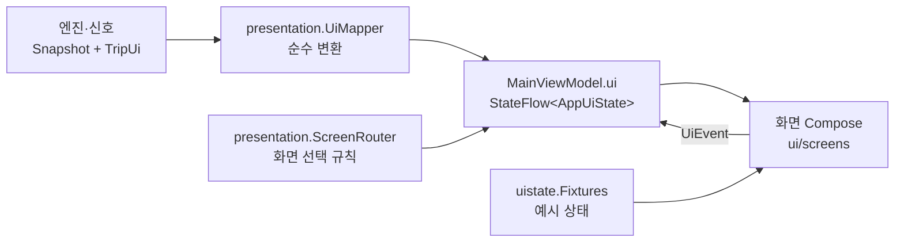

# 화면 계약 (UI Contract) — 쉼표

새 디자인(docs/design/v5/ 예정)을 받으면 **이 계약에 맞춰 Compose 화면만 갈아 끼운다.** 엔진·ViewModel·테스트는 그대로 둔다.

## 구조

| 위치 | 내용 | 디자인 교체 시 |
| --- | --- | --- |
| `:core:uistate` `ScreenStates.kt` | 화면별 상태 데이터 클래스 (순수 Kotlin, Android 의존 없음) | 그대로. 필요한 값이 없으면 여기에 필드를 추가하고 UiMapper를 고친다 |
| `:core:uistate` `UiContract.kt` | `AppUiState`, `Screen`(sealed), `UiEvent`(sealed), `Scene` | 그대로 |
| `:core:uistate` `Fixtures.kt` | 화면마다 예시 상태 (`Fixtures.screen(Scene)`) | 그대로. @Preview·발표 모드 장면 고정에 쓴다 |
| `:core:uistate` `DrivingRules.kt` | 주행 화면 제한 검사 (테스트로 고정) | 그대로 |
| `app` `presentation/` | `UiMapper`(엔진 → 상태), `ScreenRouter`(어떤 화면) | 그대로 |
| `app` `MainActivity.PauseRoot` | `Screen` → Compose 화면 호출, 버튼 → `UiEvent` | **여기와 `ui/` 아래만 바꾼다** |
| `app` `ui/components`, `ui/screens`, `ui/theme` | 현재(v2) 디자인 구현 | **통째로 교체** |

규칙
- 화면은 `AppUiState`만 읽는다. 엔진 타입(`Snapshot`, `TripUi`, `RestStop` …)을 import하지 않는다. 예외: 발표 모드 패널(`DemoPanel`)은 디버그 도구라 엔진 상태를 직접 본다.
- 화면은 `UiEvent`만 보낸다. 무엇이 일어나는지(음성 응답, 저장, 화면 전환)는 ViewModel이 정한다.
- 문구는 상태에 완성된 문자열로 들어온다(존댓말 평서문, 숫자·장소 먼저 — UI_SPEC §6). 화면은 문구를 만들지 않는다. 예외: 단위("분"), 버튼 이름.
- 색·톤은 상태의 의미 값(`FatigueTone`, `AvatarKind`, `ChipIcon`, `StopMark`, `TimelineDot`)으로 받고, 실제 색은 디자인이 정한다.

## 공통 (`AppUiState`)

| 값 | 뜻 | 화면이 할 일 |
| --- | --- | --- |
| `screen` | 지금 그릴 화면 하나 (아래 표) | 해당 화면 그리기 |
| `drivingLocked` | DriveState가 DRIVING/RESTRICTED | true면 `screen`은 항상 `Drive`. 입력창·설정·애니메이션 없음 |
| `motionAllowed` | AppMode PAUSE && PARKED && 움직임 줄이기 꺼짐 | false면 모든 자동 애니메이션 정지 (벽난로 포함) |
| `dimmed` | 파워냅 중 | Activity가 창 밝기 0.08 |
| `demoOpen`, `scene` | 발표 모드 패널 열림, 시안 장면 고정 | 패널 겹쳐 그리기 |

공통 이벤트: `LogoTap` (모든 화면의 로고. 3초 안 5번 → 발표 모드).

화면 선택 순서 (`ScreenRouter.route`, `ScreenRouterTest`):
1. 장면 고정 (시뮬레이션이거나 정차 중일 때만)
2. **DriveState DRIVING/RESTRICTED → 주행** (최우선 안전 규칙)
3. 설정 열림 → 설정
4. 온보딩 진행 중이고 멈춤이 아님 → 온보딩
5. AppMode: PREPARE → 출발 준비, DRIVING → 주행, PAUSE → (파워냅 중이면 파워냅, 아니면 멈춤), ARRIVED → 리포트

## 화면별 계약

### 주행 `Screen.Drive(DriveUi)` — 시안 01·06·07
주행 화면 하나가 아래 여러 상태를 `content`·`voice`·`offline`으로 나눠 그린다.

| 값 | 표시 |
| --- | --- |
| `meta` | 상단 "부산까지 3시간 20분" (없으면 숨김) |
| `content` | `Next` / `Calm` / `Urgent` 중 하나 (아래) |
| `fatigue` | 피로 점수(0~100)·`tone`·설명 한 문장. null이면 카드 숨김 |
| `family` | 가족 줄 최대 3개 (`kind`, 이름, 한 줄) |
| `journey` | 경로선: 진행 비율, 쉼표 위치(`NEXT`/`UPCOMING`/`PAST`)와 라벨, 출발·도착 이름 |
| `restricted` | RESTRICTED: 오른쪽 카드를 숨기고 가장 급한 한 줄만 |
| `toast` | 결과 한 줄 ("경로에 안성휴게소를 넣었어요") |

| `content` | 표시 | 버튼 → 이벤트 |
| --- | --- | --- |
| `Next(asking = true)` 제안 | "다음 쉼표까지" + 분 + 장소 + 부제 + 이유 칩 ≤3 + 음성 힌트 | `여기서 쉴게요` → `AcceptSuggestion`, `다음 곳으로` → `DeclineSuggestion` |
| `Next(asking = false)` 가는 중 | 같은 정보, 버튼 없음 | — |
| `Calm` 제안 없음 (시안 08) | 한 문장 + 칩 | — |
| `Urgent` 긴급 (시안 09) | 피로 점수, 가장 가까운 쉼터, km | `여기서 쉴게요` → `AcceptSuggestion` (거절 버튼 없음) |

| `voice` | 표시 | 버튼 |
| --- | --- | --- |
| `LISTENING` 듣는 중 (시안 10) | 뒤 화면 흐리게 + 듣는 중 시트 | 없음 (음성만) |
| `FAILED` 음성 실패 (시안 11) | "잘 못 들었어요" 시트 | `여기서 쉴게요` → `AcceptSuggestion`, `다음 곳으로` → `DeclineSuggestion` |

| `offline` | 오프라인 (시안 12): 얇은 배너 "인터넷 없이 안내 중", 음성 힌트 숨김 |

### 출발 준비 `Screen.Prepare(PrepareScreenUi)` — 시안 02 (정차 중만)

| 값 | 표시 |
| --- | --- |
| `meta` | "부산까지 예상 4시간 30분" |
| `members` | 동승자 타일 (`id`, 라벨, `kind`, 선택 여부) |
| `sleepHours` | 4..8 (8 = 8시간+), null = 안 고름 |
| `proactive` | "미리 쉬기" 토글 |
| `plan` | 쉼표 계획 줄 (이름, 편의시설, "1시간 40분 뒤") |
| `journey` | 계획 경로선 (진행 0) |
| `rationale` | 계획 근거 한 문장 |

| 버튼 | 이벤트 |
| --- | --- |
| 동승자 타일 | `ToggleMember(id)` (`relief`·`kid`·`dog`) |
| 수면 알약 | `SetSleep(hours)` |
| 미리 쉬기 | `ToggleProactive` |
| 이대로 출발 | `StartTrip` (Activity가 마이크 권한을 먼저 묻는다) |
| 바꾸기 | `OpenSettings` |

### 멈춤 `Screen.Pause(PauseScreenUi)` — 시안 03

| 값 | 표시 |
| --- | --- |
| `meta`, `lead`, `number`, `unit` | "안성휴게소에서 쉬는 중" / "충전이 끝날 때까지" 28 분 |
| `battery` | SoC %, 목표 %, 충전 상태 문구, 완료 예상 시각 (충전 정보 없으면 null) |
| `restChoice` | 충전이 아닌 정차: 10/15/20 중 선택값 (충전 중이면 null) |
| `activities` | 활동 카드: `kind`(NAP·EXPEDITION·PET_WALK·FOCUS·STRETCH), 대상, 제목, 설명, 버튼 이름, 추천 여부, `enabled`, `badge` |
| `timeline` / `nowFraction` | 정차 타임라인 점(`PAST`/`NOW`/`ALARM`/`END`, 시각, 라벨) |
| `notice` | "충전 정보 없음 — 쉬실 시간을 골라 주세요." |

| 버튼 | 이벤트 |
| --- | --- |
| 활동 카드 버튼 | `StartActivity(kind)` (NAP이면 파워냅 화면으로) |
| 10·15·20분 | `SetRestMinutes(minutes)` |

### 파워냅 `Screen.Nap(NapUi)` — 시안 04 (`dimmed = true`)

| 값 | 표시 |
| --- | --- |
| `remainingSec` / `totalSec` | 남은 시간 (1분 단위, 마지막 1분만 초), 진행 링 |
| `wakeLine` | "13:10에 깨워 드릴게요" |
| `soundOn` | 장작 소리 |
| `waking` | 남은 2분 이하: 기상 단계 (조명 밝게) |

| 버튼 | 이벤트 |
| --- | --- |
| 지금 일어나기 | `Wake` |
| 10분 더 | `NapMore` |
| 소리 | `ToggleNapSound` |

벽난로 움직임은 `motionAllowed`일 때만. 주행이 시작되면 라우터가 즉시 주행 화면으로 바꾼다 (T6-6).

### 리포트 `Screen.Report(ReportUi)` — 시안 05

| 값 | 표시 |
| --- | --- |
| `meta` | "10월 29일, 부산까지" |
| `sentence` | 쉼표 자리에서 끊은 문장 조각 (조각 사이에 쉼표 기호) |
| `distanceKm`, `stops`, `longestMin` | 요약 숫자 3개 |
| `log` | 정차 기록 (이름, 태그, 도착 시각, 머문 시간) |
| `fatigueSeries`, `restMarks` | 피로 흐름(0~100, 5분 간격)과 쉼표 위치(0~1) |
| `tip` | 다음 여행 팁 한 문장 |

버튼: 확인 → `FinishReport`.

### 온보딩 `Screen.Onboard(OnboardUi)` — 시안 13~15 (정차 중만)

| `step` | 표시 | 버튼 → 이벤트 |
| --- | --- | --- |
| `CONCEPT` | 앱이 하는 일 | 다음 → `OnboardNext` |
| `MEMBERS` | `members` 타일 (운전자 제외, 어른은 1명/2명 한 타일) | 타일 → `ToggleMember(id)`, 나중에 할게요 → `OnboardNext`, 다음 → `OnboardNext` |
| `MIC` | 마이크 권한 이유 | 마이크 허용하고 시작 → `AllowMic`, 버튼으로만 쓸게요 → `ButtonsOnly` |

### 설정 `Screen.Settings(SettingsUi)` — 시안 16 (정차 중만)

| 값 | 표시 |
| --- | --- |
| `section` | 왼쪽 목록 선택 (`SUGGEST`·`FAMILY`·`SIGNALS`·`PRIVACY`·`ABOUT`) |
| `timing` | 제안 민감도 0 빠르게 · 1 보통 · 2 여유 |
| `voiceSuggest`, `kidAnswer`, `napSound`, `reduceMotion` | 토글 |
| `signals` | "이 차에서 쓰는 신호" 줄 (이름, 사용 여부, 출처) |
| `members` | 동승자 |
| `version` | 앱 버전 |

| 버튼 | 이벤트 |
| --- | --- |
| 섹션 | `SelectSettingsSection(section)` |
| 민감도 | `SetTiming(value)` |
| 음성 제안 / 아이 답변 / 장작 소리 / 움직임 줄이기 | `ToggleVoice` / `ToggleKidAnswer` / `ToggleNapSound` / `ToggleReduceMotion` |
| 동승자 | `ToggleMember(id)` |
| 모두 지우기 | `DeleteData` |
| 닫기 | `CloseSettings` |

## 빈·로딩·오류 상태 (COMMERCIAL_READINESS H P0, `EmptyStatesTest`)

문구는 상태에 완성돼 들어온다. 화면은 값이 null이거나 비었을 때 아래처럼 그린다.

| 화면 | 상황 | 상태 값 | 화면이 할 일 |
| --- | --- | --- | --- |
| 주행 | 경로·ETA 없음 (내비 목적지 미설정) | `meta = null`, `journey = null` | 상단 메타·경로선 숨김 |
| 주행 | 피로 계산 전 (출발 직후) | `fatigue = null` | 피로 카드 숨김 |
| 주행 | 동승자 없음 | `family = []` | 가족 카드 숨김 |
| 주행 | 쉴 필요 없음 / 앞쪽 후보 없음 | `content = Calm("지금 컨디션이면 …")` | 편안 카드 |
| 주행 | 서버 꺼짐 (캐시·내장 데이터 사용) | `offline = true` | 오프라인 배너, 음성 힌트 숨김 |
| 주행 | 휴게소 받는 중 (로딩) | `offline = false`, 계획 없음 | 배너 없이 편안 카드 (로딩 표시 없음 — 주행 중 깜빡임 금지) |
| 주행 | 음성 인식 실패 | `voice = FAILED` | 버튼 시트 |
| 주행 | 경유지 추가 실패 | `toast = "OO휴게소까지 N km 남았어요. 표지판을 따라가 주세요."` | 결과 한 줄 |
| 출발 준비 | 경로 없음 | `plan = []`, `journey = null`, `rationale = "경로를 받으면 쉴 곳을 잡아 드려요."` | 계획 목록 자리에 근거 문장 |
| 출발 준비 | 수면 미선택 | `sleepHours = null`, 근거 "수면 시간을 고르지 않아 7시간으로 계산했어요." | 알약 모두 꺼짐 |
| 멈춤 | 충전 정보 없음 | `battery = null`, `notice = "충전 정보 없음 — 쉬실 시간을 골라 주세요."` | 배터리 카드 대신 안내, 10·15·20분 |
| 멈춤 | 배터리 신호 없는 차 | `battery = null`, `restChoice = 15` | 시간 고르기 |
| 멈춤 | 정차 위치 모름 | `meta = "쉬는 중"` | 휴게소 이름 없이 |
| 멈춤 | 아이 없음 | `missions = []` | 원정대 없음 |
| 리포트 | 정차 기록 없음 | `log = []`, `fatigueSeries = [0, 0]` | 기록 목록 숨김, 평평한 그래프 |
| 설정 | 차량 신호 미지원 | `signals[i].inUse = false`, `source = null` | "이 차에서는 쓰지 않아요" |

## 주행 중 제한 (모든 디자인 공통)

| 규칙 | 근거 | 확인 방법 |
| --- | --- | --- |
| DriveState DRIVING/RESTRICTED면 무조건 주행 화면 (설정·온보딩·파워냅·멈춤 무시) | architecture §5 | `ScreenRouterTest` (T6-6, T1-6) |
| 텍스트 덩어리 2줄 이하 (`DrivingRules.MAX_BLOCK_CHARS` 48자), 장소 이름 14자 | UI_SPEC §4.1, T4-12 | `DrivingRulesTest` |
| 버튼 최대 2개 (제안 2 · 긴급 1 · 제안 없음 0 · 음성 실패 시트 2) | T4-12 | `DrivingRulesTest` |
| 칩 최대 3개, 가족 줄 최대 3개 | UI_SPEC §4.1 | `DrivingRulesTest` |
| 스크롤 없음, 키보드 없음, 영상 없음 | T10-2 | 화면 구현 규칙 (주행 화면에 스크롤 컨테이너·TextField 금지) |
| 자동 애니메이션은 `motionAllowed`일 때만 | architecture §5, T6-11 | `ScreenRouterTest` |
| RESTRICTED면 오른쪽 카드 숨김, 가장 급한 한 줄만 | UI_SPEC §4.1 | `DriveUi.restricted` |
| 발표 모드 패널은 실차 주행 중 열리지 않음 | COMMERCIAL_READINESS I | `ScreenRouterTest` |

## 예시 상태 (Fixtures)

`Fixtures.screen(Scene.X)`가 시안과 같은 상태를 만든다. 새 디자인의 @Preview는 이 값으로 그리면 된다.
`DRIVE`·`HALF`·`THIRD`·`CALM`·`URGENT`·`LISTENING`·`VOICE_FAIL`·`OFFLINE`·`PREPARE`·`PAUSE`·`NAP`·`REPORT`·`ONBOARD1~3`·`SETTINGS`.
에뮬레이터에서는 `adb shell am start -n com.emop.pause/.MainActivity --es scene <이름>`(디버그 빌드)로 고정해 볼 수 있다.
