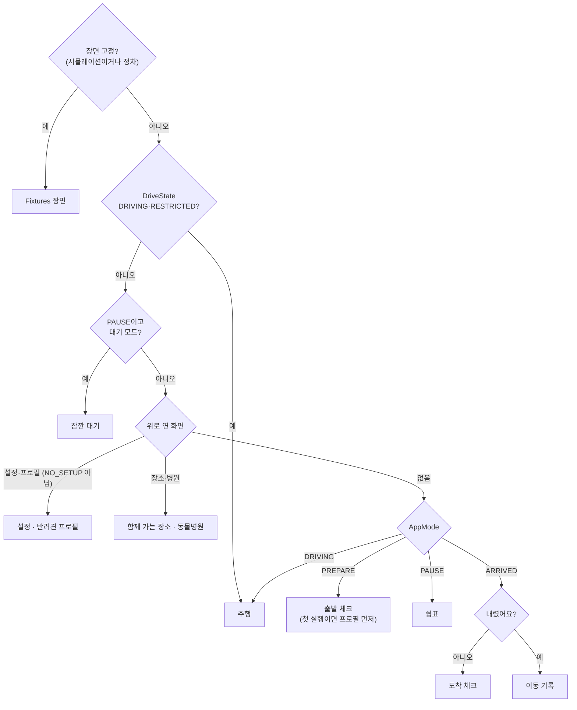

# 화면 계약 — 같이가개 (UiState · UiEvent · 주행 중 제한)

디자인(docs/design/v5/)이 오기 전까지 화면은 **동작 확인용 최소 레이아웃**이다. 새 디자인은 `app/.../ui/screens/PetScreens.kt`·`ui/components/Kit.kt`와 `MainActivity.PauseRoot`만 바꾸고, 아래 계약(`:core:uistate`)은 그대로 둔다.

- 상태: `core/uistate/.../ScreenStates.kt`, 바깥 틀 `UiContract.kt`(`AppUiState`·`Screen`·`UiEvent`·`Scene`)
- 엔진 → 상태: `app/.../presentation/UiMapper.kt` (순수 함수, `EmptyStatesTest`·`DrivingUiScenarioTest`)
- 화면 선택: `app/.../presentation/ScreenRouter.kt` (순수 함수, `ScreenRouterTest`)
- 미리보기·발표 모드 장면 고정: `Fixtures.screen(Scene)`
- 에뮬레이터 캡처(2026-10-29): `artifacts/pet/01-depart.png` … `06-arrival.png` (로컬, gitignore)

## 화면 선택

## 화면별 계약

| 화면 (`Screen`) | 상태 필드 | 이벤트 (`UiEvent`) | 언제 | 주행 중 |
| --- | --- | --- | --- | --- |
| 출발 체크 `Depart` | `meta`, `pet`(이름·한 줄·샘플), `checks`(하네스/켄넬·물·배변봉투), `ready`, `plan`(오늘의 쉼표), `rationale`, `limitLine` | `ToggleCheck`, `StartTrip`(ready일 때만), `OpenPet`, `OpenSettings` | PREPARE | 열리지 않음 |
| 주행 `Drive` | `meta`, `motion`(지수·단계·한 줄), `content` = `Calm` 안내 · `Forecast` 멀미 예보 · `Suggest` 쉼표 추천 · `Heading` 가는 중, `voice`, `toast`, `restricted`, `offline` | `AcceptSuggestion`, `DeclineSuggestion` | DRIVING 또는 DriveState 제한 | 아래 "주행 중 제한" |
| 쉼표 추천 (`Drive.Suggest`) | `minutes`, `place`, `reasons`(기여 상위 1~2개), `urgent`(운전자 피로 위험 → 버튼 1개) | 위와 같음 + 음성 "여기서 쉴게요"/"나중에" | 플래너가 제안할 때 | 버튼 2개 + 음성 힌트 |
| 쉼표 `Rest` | `meta`, `lead`, `minutes`, `restChoice`(10/15/20), `activities`(산책·물/배변·스트레칭, 추천 1개), `motion`, `waitLimitMin`, `battery` | `SetRestMinutes`, `StartActivity`, `StartWait`, `OpenPlaces`, `OpenVets` | PAUSE | 주행 화면으로 바뀜 |
| 잠깐 대기 `Wait` (바깥 사람용) | `headline`("주인이 곧 돌아와요"), `elapsed`, `cabin`(없으면 "실내 온도 정보 없음"), `battery`, `limitMin`, `overdue`, `share`(폰 주소·연결) | `StopWait`, `SetWaitLimit` | PAUSE + "잠깐 다녀올게" | 즉시 끝남 (F3-04) |
| 함께 가는 장소 `Places` | `items`(이름·분류·거리·정책·샘플), `note`(출처), `loading` | `GoPlace`(경유지), `Close` | 정차 중 쉼표 화면에서 | 열리지 않음 |
| 동물병원 `Vets` | `items`(이름·거리·주소·전화(실데이터만)·샘플), `note`, `loading` | `GoVet`(경유지로 안내), `Close` | 정차 중 | 열리지 않음 |
| 도착 체크 `Arrival` | `question`("콩이 내렸나요?"), `strong`(26℃↑·여름), `detail` | `ConfirmLeft` | ARRIVED, 확인 전 | — |
| 이동 기록 `TripLog` | `summary`(LLM·템플릿), `durationMin`, `stops`, `motionPeak`, `motionSeries`, `limitLine`, `vetSummary`, `symptoms` | `ToggleSymptom`, `FinishTrip` | ARRIVED, 확인 후 | — |
| 반려견 프로필 `PetProfile` | `name`, `size`, `ageYears`, `tendency`, `pottyIntervalMin`, `petZonePreferred`, `problems`, `firstRun` | `SetPetName`, `SetPetSize`, `SetPetAge`, `SetPetTendency`, `SetPotty`, `TogglePetZone`, `SavePet`, `Close` | 첫 실행 또는 "바꾸기" | 열리지 않음 (키보드) |
| 설정 `Settings` | `timing`, `voiceSuggest`, `reduceMotion`, `signals`(쓰는 신호와 출처), `version` | `SetTiming`, `ToggleVoice`, `ToggleReduceMotion`, `DeleteData`, `Close` | "설정" | 열리지 않음 |

공통: `LogoTap`(3초 안 5번 → 발표 모드 패널, 실차 주행 중에는 숨김).

## 주행 중 제한 (CONCEPT 5장, test_plan DS-01~DS-04)
- 텍스트 덩어리 48자(2줄) 이하, 장소 이름 14자 이하, 이유 2개 이하 — `DrivingRules.violations`가 0이어야 한다(시나리오 전 구간 테스트).
- 버튼은 쉼표 추천 2개(피로 위험 1개), 음성 실패 시트 2개, 그 밖에는 0개. 음성 힌트 한 줄.
- 스크롤·키보드·자동 애니메이션 없음. 주행 화면은 스크롤 없는 `Page(scroll = false)`.
- RESTRICTED: 멀미 줄·이유 알약을 숨기고 가장 급한 한 줄만.
- LIMIT_STRING_LENGTH: 첫 문장만, 이유는 1개 (`UxPolicy.apply`).
- 멀미 예보 문구는 이름이 길어 48자를 넘으면 이름을 빼고 말한다 (`MotionPhrases`).

## 빈·로딩·오류 상태
| 상황 | 화면 |
| --- | --- |
| 경로·엔진 값 없음 | 주행: 메타·멀미 줄 없이 안내 한 줄 |
| 서버 없음 | 휴게소·장소·병원은 앱 내장 샘플("샘플" 알약), 주행 화면 아래 "인터넷 없이 내장 데이터로 안내 중" |
| 실내 온도 신호 없음 | 대기: "실내 온도 정보 없음" (지어내지 않음) |
| 폰 공유 실패 | 대기: "폰 공유 연결 안 됨 — 차 화면 안내는 계속돼요" |
| 장소·병원 찾는 중 / 없음 | "찾는 중…" / "근처에 찾은 곳이 없어요." |
| 프로필 미저장 | 출발 체크 `pet.sample = true`, 첫 실행이면 프로필 화면 |
