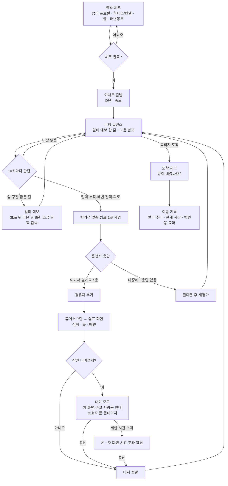
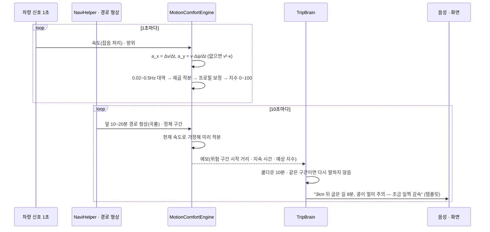
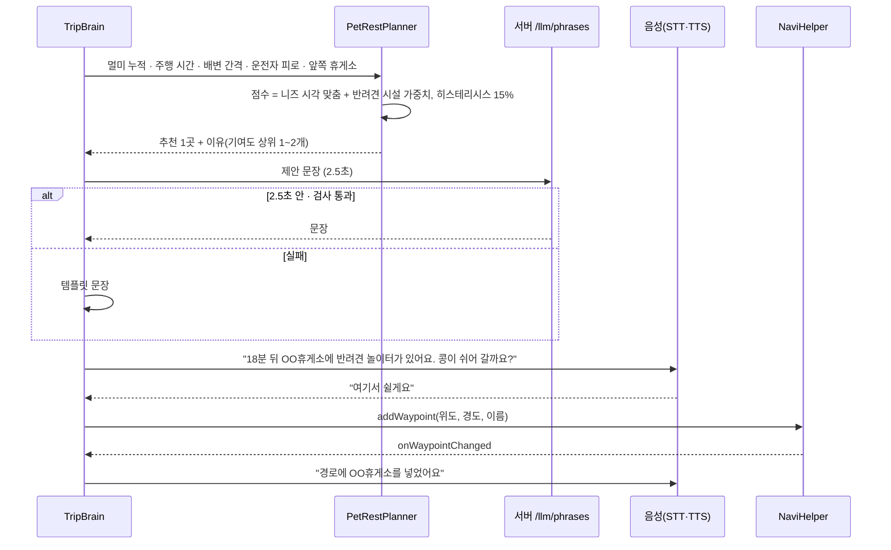
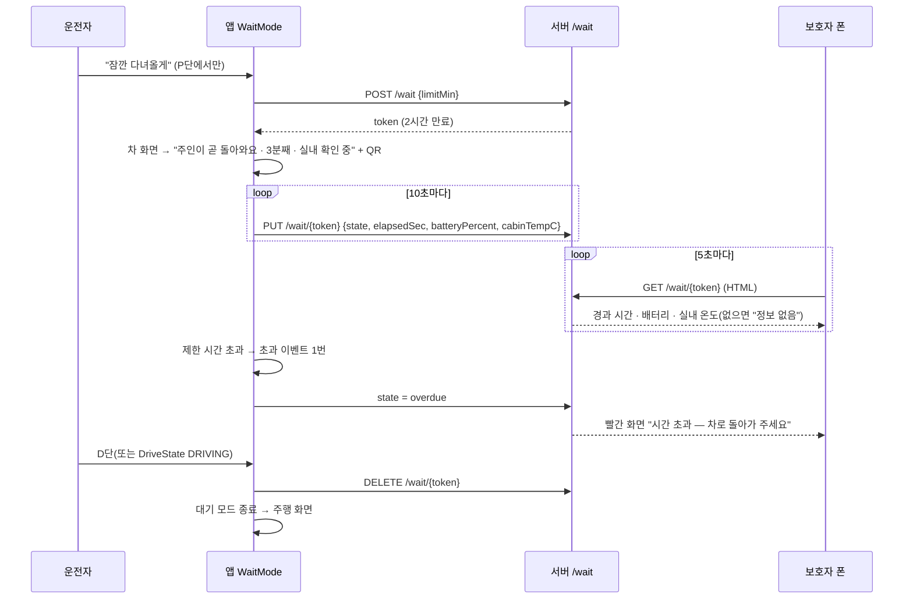
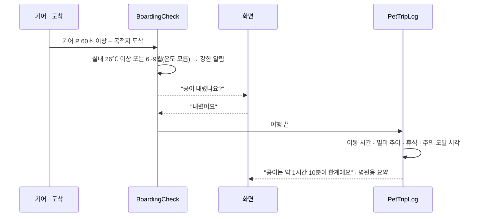
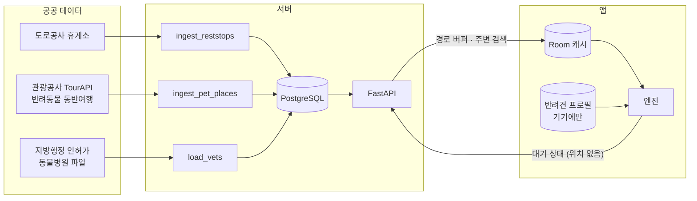

# 흐름도 — 같이가개 (반려견과 차로 가는 모든 순간)

## 1. 핵심 유저 저니 (CONCEPT 7장 시연 흐름)

## 2. 시퀀스 — 멀미 예보 (F1)

## 3. 시퀀스 — 반려견 맞춤 쉼표와 경유지 추가 (F2)

## 4. 시퀀스 — 잠깐 대기 모드 (F3)

## 5. 시퀀스 — 도착 체크와 이동 기록 (F6·F7)

## 6. 데이터 흐름

키가 없으면 각 잡은 `server/app/data/sample_*.json`을 같은 정규화 경로로 적재하고 `source=sample`을 남긴다. 앱은 같은 샘플을 내장 데이터로 묶어 서버 없이도 동작한다.

## 7. 예외 흐름 요약

| 상황 | 동작 |
| --- | --- |
| 서버 없음 | 휴게소·장소·병원은 내장·캐시 데이터, 문장은 템플릿, 대기 모드는 차 화면만("폰 공유 연결 안 됨") |
| LLM 2.5초 초과·검사 실패 | 템플릿 문장 |
| 방위·경로 형상 없음 | 종방향 가속만으로 멀미 지수, 예보는 "곡선 정보 없음" |
| 실내 온도 신호 없음 | "실내 온도 정보 없음"으로 표시, 여름철이면 도착 체크를 강한 단계로 |
| 음성 인식 실패 | 한 번 더 묻고, 그래도 모르면 버튼만. 응답 없음은 "나중에" |
| 주행 시작(D단·DRIVING) | 대기 모드·쉼표 화면·설정을 즉시 닫고 주행 화면 |
| 경유지 추가 실패 | "경로에 넣지 못했어요. 내비에서 직접 골라 주세요" |
