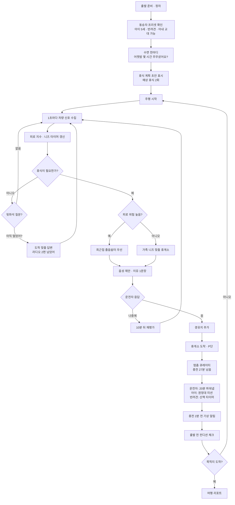
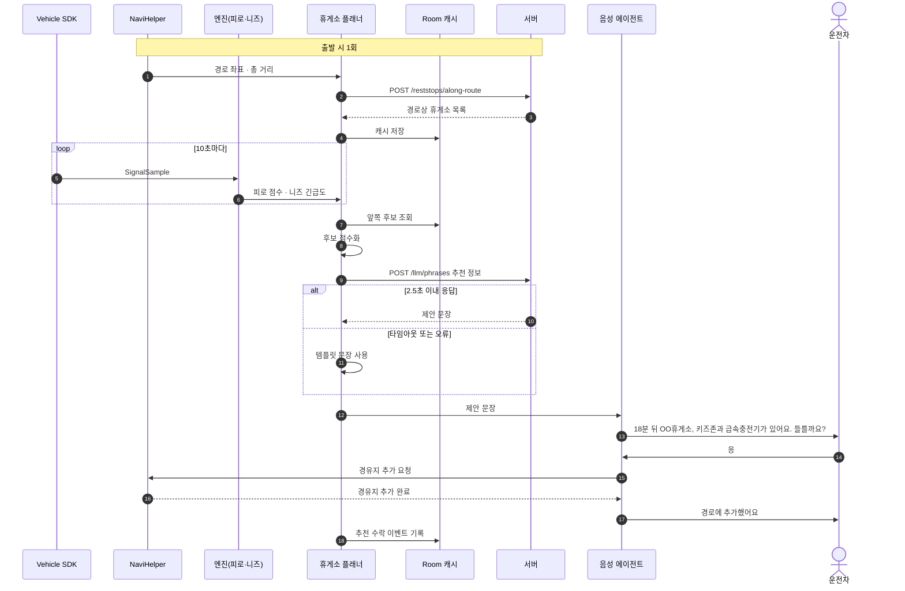
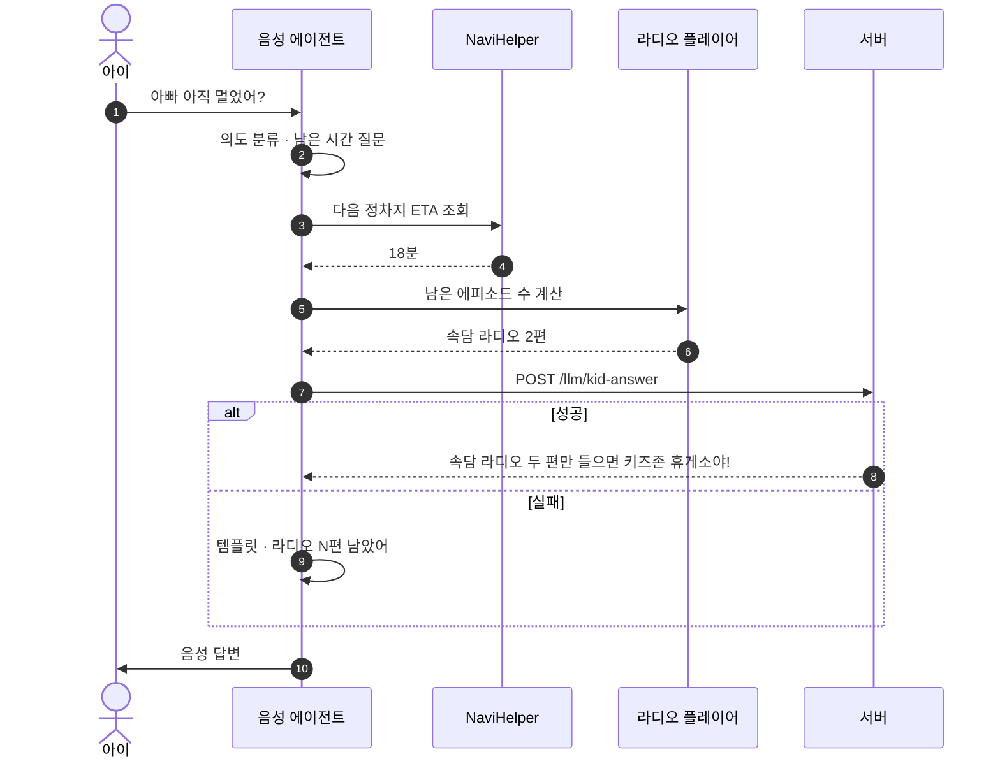
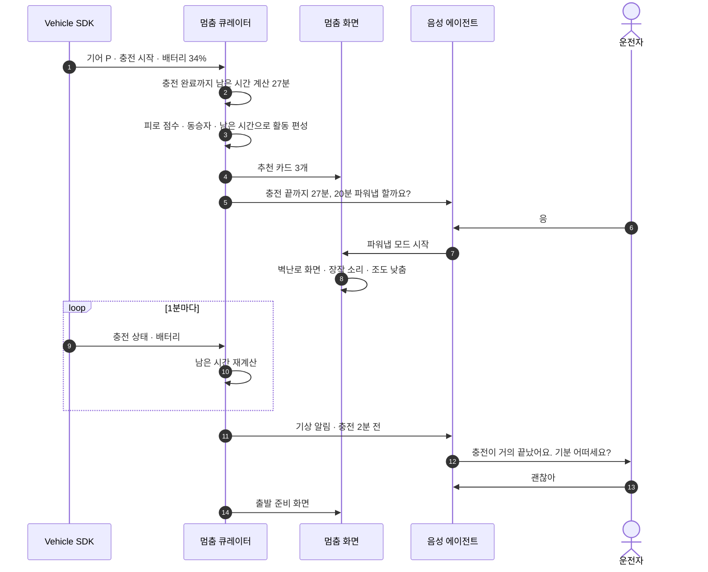
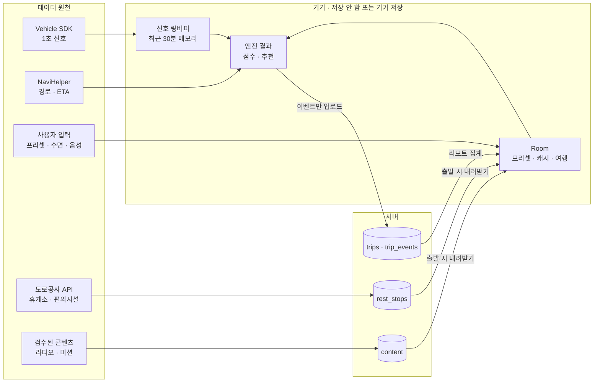
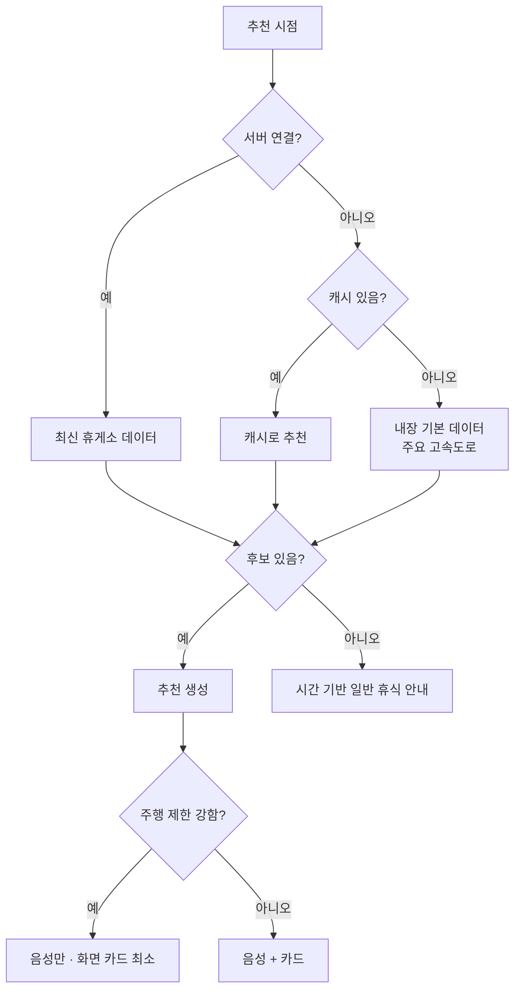

# 흐름도 — 쉼표 (멈춤의 모든 순간)

## 1. 핵심 유저 저니 (전체)

페르소나: 아빠 운전자(38), 아내·5세 아이·반려견과 서울→부산 5시간, 전기차.

## 2. 시퀀스 — 휴게소 추천과 경유지 추가

## 3. 시퀀스 — "아직 멀었어?" 응답기

## 4. 시퀀스 — 충전 대기 멈춤 큐레이터

## 5. 데이터 흐름

| 데이터 | 생성 위치 | 저장 위치 | 서버 전송 |
| --- | --- | --- | --- |
| 1초 차량 신호 | Vehicle SDK | 메모리 링버퍼 30분 | 안 함 |
| 동승자 프리셋 · 수면 시간 | 사용자 | Room | 안 함 |
| 경로 좌표 | NaviHelper | 메모리 | 휴게소 조회 시에만, 저장 안 함 |
| 휴게소 · 편의시설 | 도로공사 API | PostgreSQL → Room 캐시 | 내려받기 |
| 라디오 · 미션 | 검수 JSON | PostgreSQL → Room 캐시 | 내려받기 |
| 여행 이벤트 | 엔진 | Room → PostgreSQL | 일괄 업로드 (휴게소 ID · 시각 · 종류) |

## 6. 예외 흐름 요약

